    网页导航
    [navisec](https://navisec.io/)
    [渗透师](https://www.shentoushi.top/)
    https://tools.qsnctf.com/#//home

## 工具
    binwalk  
    file  
    zsteg  
    010editor
    zbarimg xxx.png //扫码工具
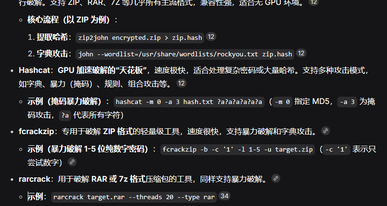
Base64 特征：字符集 A-Z a-z 0-9 + /，末尾常有 = 填充。
Base32 特征：字符集 A-Z 2-7，通常全大写，长度是 8 的倍数，末尾常有 =。
URL Safe Base64：把 + / 换成 - _，解码前先替换：
```bash
    echo "你的字符串" | tr '_-' '/+' | base64 -d
```
    在线网址：http://www.hiencode.com/base64.html
    循环反复尝试 base64 / base32。  
    在线hex转文件的网址  https://gchq.github.io/CyberChef/  
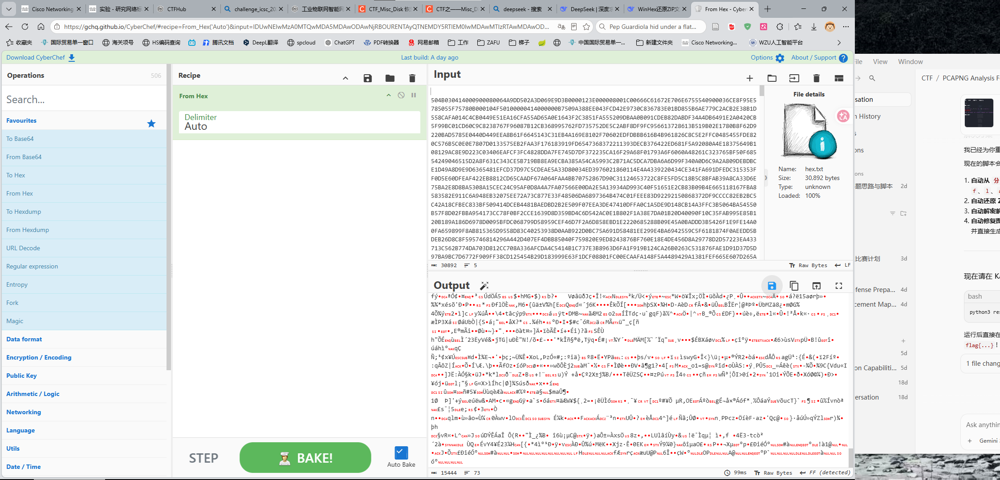
    将文件拖入input，左侧选择for hex  
    output选择save  
## 基本赛制与题型  
    题目 ---》 flag ---> 分数 ---》名次
    i春秋，e春秋
## 目标
    获取flag

## 比赛形式
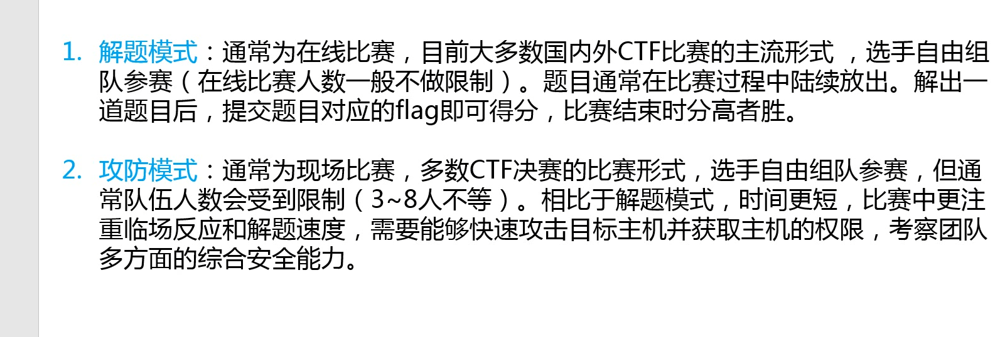
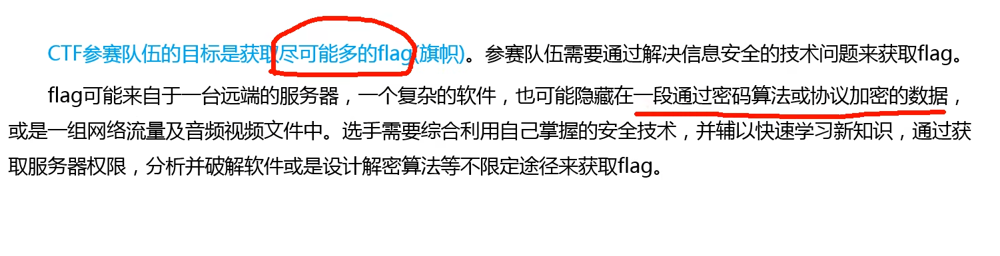
## 题目类型
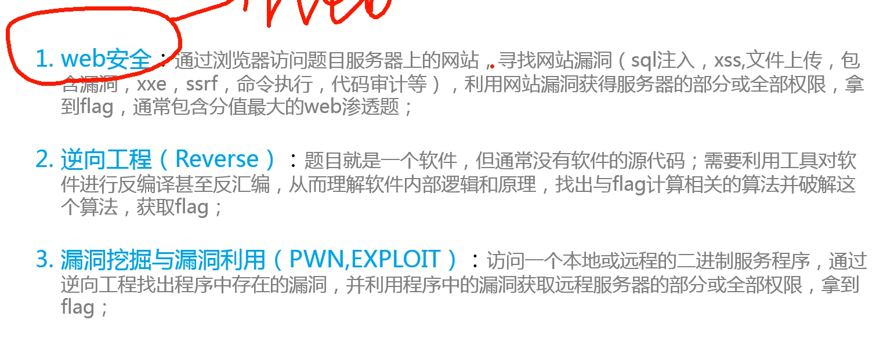
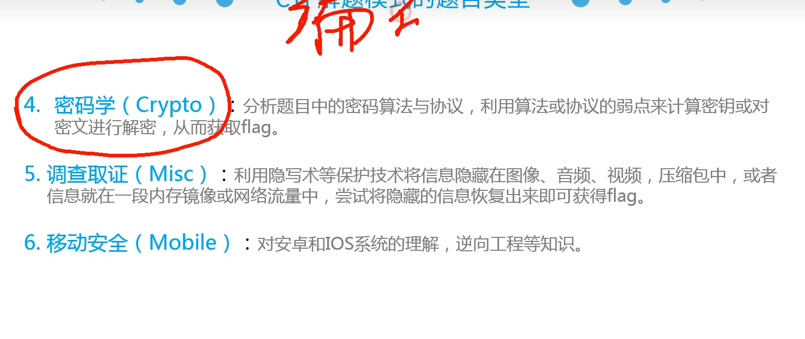
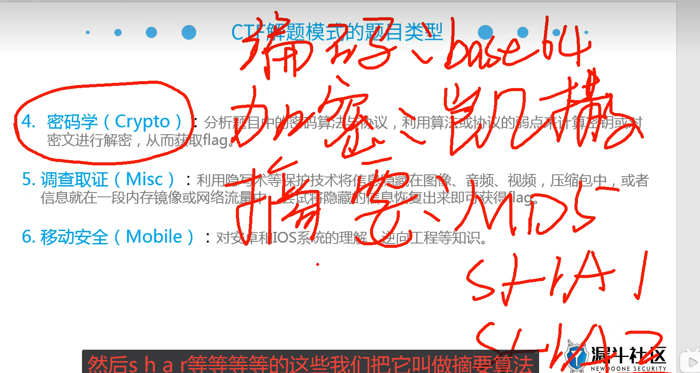
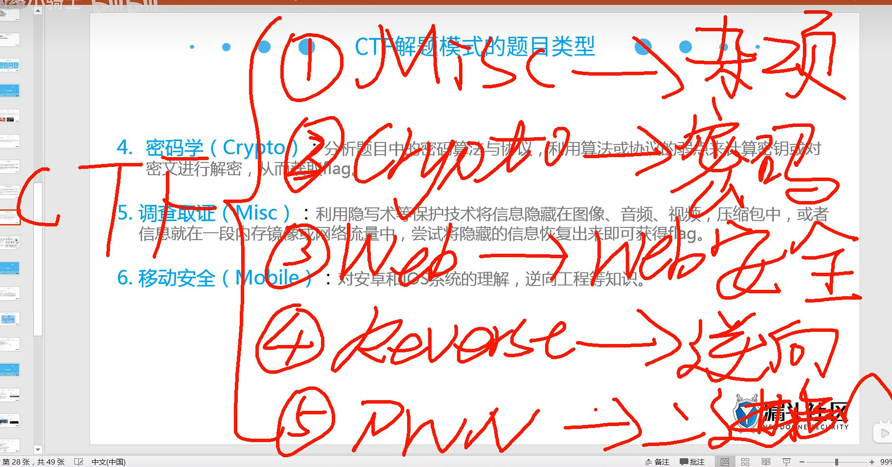

## 学习攻略

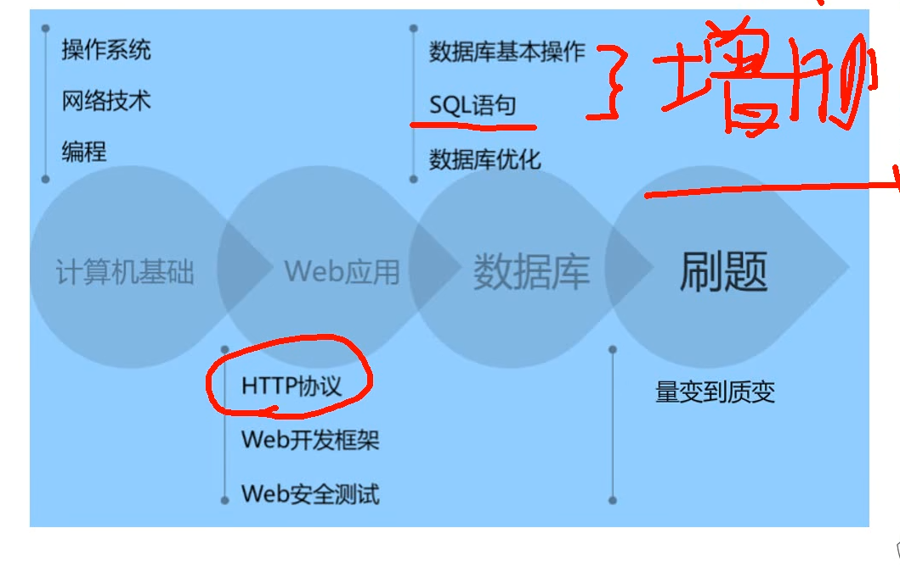
*  网络技术
*  http协议
*  数据库的基本操作，Sql语句（增删查改，ADFC），数据库优化

## 在线演练

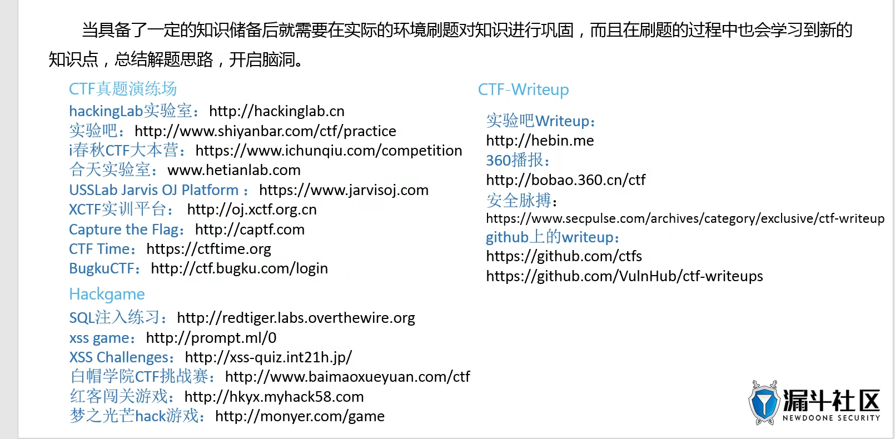

    实验吧：http://shiyanbar.com/ctf/practice
    BugkuCTF: http://ctf.bugku.com/login
# 软件
    vm，bp
    kalilinux:已经安装了很多的软件和工具
```bash
    firefox-esr //狐火
```
# misc思路
    1，先查看文件类型 
    {
        有些时候是假的文件头，就要进行替换  
        可以先直接进行vim或者010查看并搜索flag字样
    } 
    根据类型进行下一步
    2，如果是图片先看看exif(查看图片信息)
    {
        若png有问题在在线工具中进行修复尺寸  
        png还会有LSB隐写{
            使用zsteg
        }
    }
    3，查看隐藏文件是否有
    {
        有的话就分离  
        foremost  
        binwalk
        dd
        根据分离的文件类型可能是zip，rar的压缩类型
        {
            zip如果是加密的话可以先看看是不是伪加密的  
            用16进制编辑器进入后，搜索504B0102，后的第5，6个字符，改成0000  
            rar的话是第24位的尾数改为0，4是加密
            {
                如果是真加密
            }
        }
        非压缩类型再次vim或010查找flag  
        {
            有二维码可以通过QRsearch  
            或者zbarimg xxx.png
        }

        }


# 杂项的解题思路

## 文件类型的识别

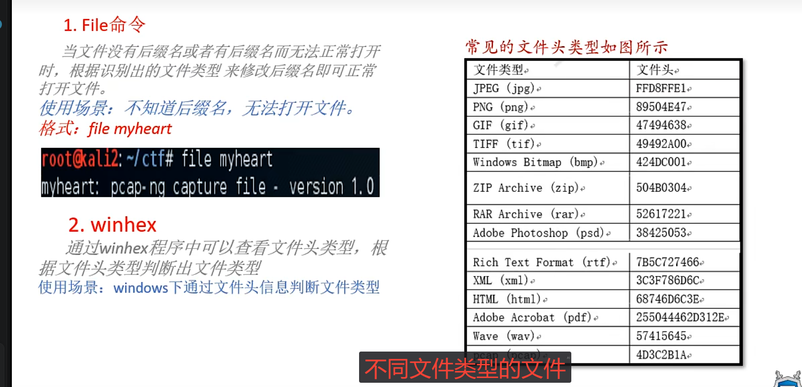
```bash

    file xxxx
```
    更改后缀名，可以将文件的原貌得出
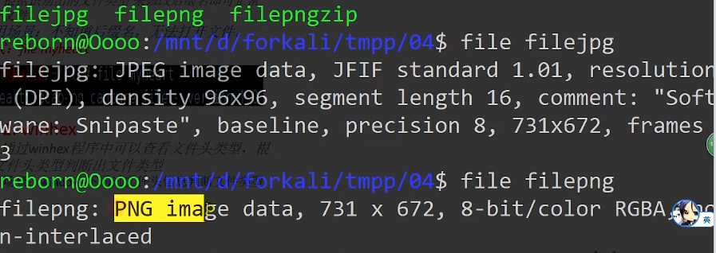

```bash
    winhex //通过识别文件头，用于windows下的情况
```

```bash
    010editor filename
```
    通过010编辑器打开文件，通过查看头文件的第一位16位数值来判断是什么文件

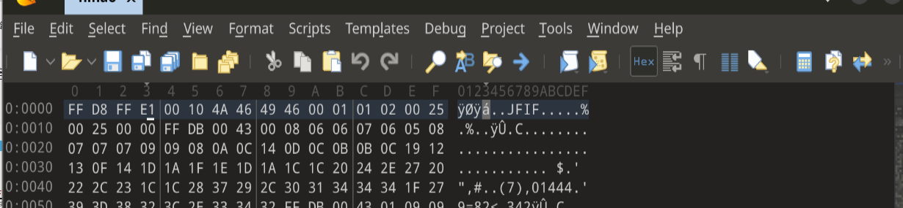

## 文件分离

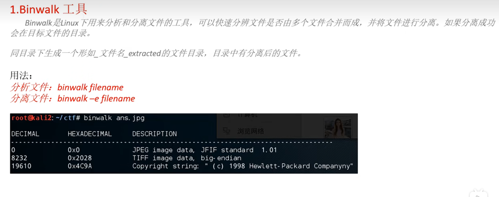

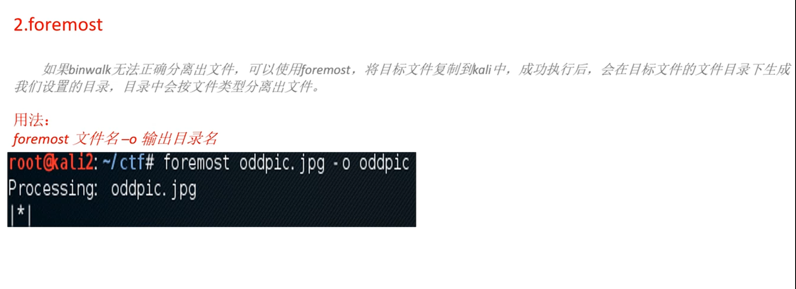

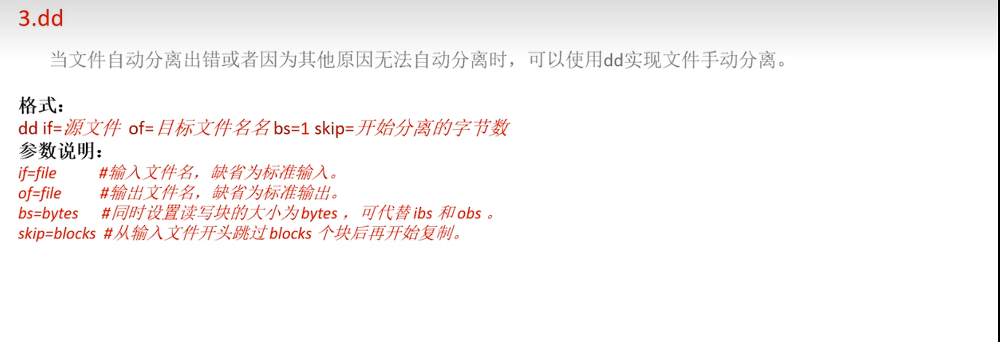

    EX1  
    1.txt:1234567890abcdefghjk  
    dd if=1.txt of=2.txt bs=5 count=1  
    2.txt:12345  
    dd if=1.txt of=3.txt bs=5 count=2  
    3.txt:1234567890
    dd if=1.txt of=4.txt bs=5 count=1 skip=1  
    4.txt:67890    

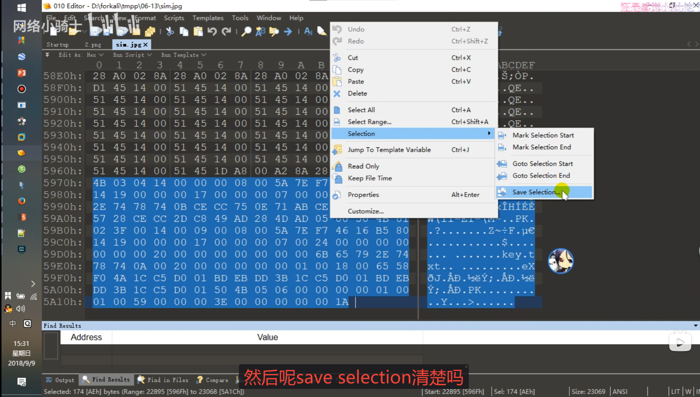

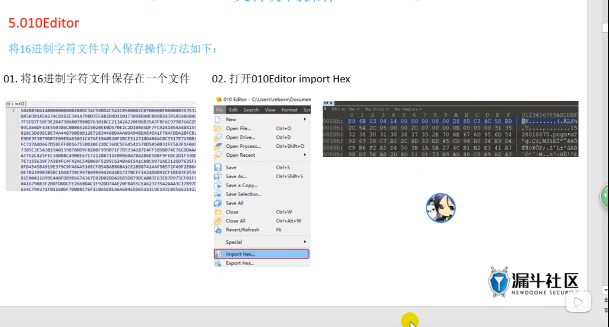

## 文件合并

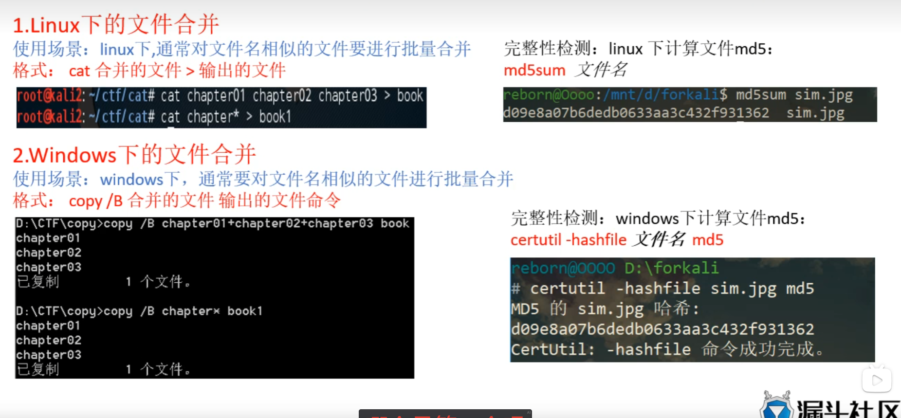
    合并后还要根据md5来判断是否合并成功  

## 图片隐写

### 细微的颜色差异

### GIF多帧隐藏  
- 颜色通道隐藏
- 不同帧图信息隐藏
- 不同帧对比隐写

### Exif信息隐藏

``` bash
    exiftool filename
```
### Steglove 
! [alt text](image-18.png)
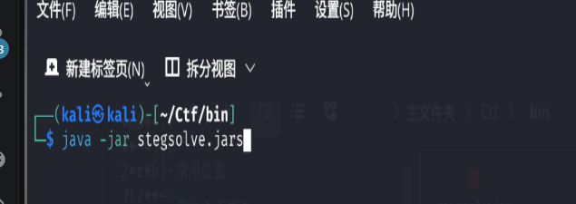
### 图片修复
- 图片头修复
- 尾修复
- crc循环效验修复
- 长宽高修复
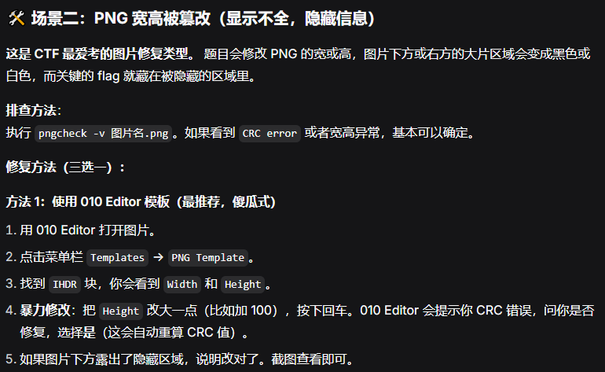
```python
import zlib
import struct

filename = "图片名.png"
# 读取文件数据
with open(filename, 'rb') as f:
    data = bytearray(f.read())

# PNG 的 IHDR 块从第 16 字节开始，宽 4 字节，高 4 字节
# 利用已知 CRC 来爆破高度（因为修改宽高会导致 CRC 校验失败，我们反过来利用 CRC 去猜高度）
crc32_expected = struct.unpack(">I", data[29:33])[0] # 原始 CRC

for h in range(1, 2000): # 假设高度在 2000 以内
    # 修改高度字段
    data[20:24] = struct.pack(">I", h)
    # 计算新的 CRC (PNG 的 CRC 是根据 "IHDR" + 宽 + 高 + 位深 + 颜色类型 + 压缩 + 过滤 + 隔行扫描 计算的)
    crc32_calc = zlib.crc32(data[12:29]) & 0xffffffff
    if crc32_calc == crc32_expected:
        print(f"找到正确高度: {h}")
        with open("fixed.png", "wb") as f:
            f.write(data)
        break
```
### 最低位有效位LSB隐写
    Stegslove可以用来处理LSB隐写，在DATA EXact中
    对于图像的RGB有8位，把信息隐藏在最后一位
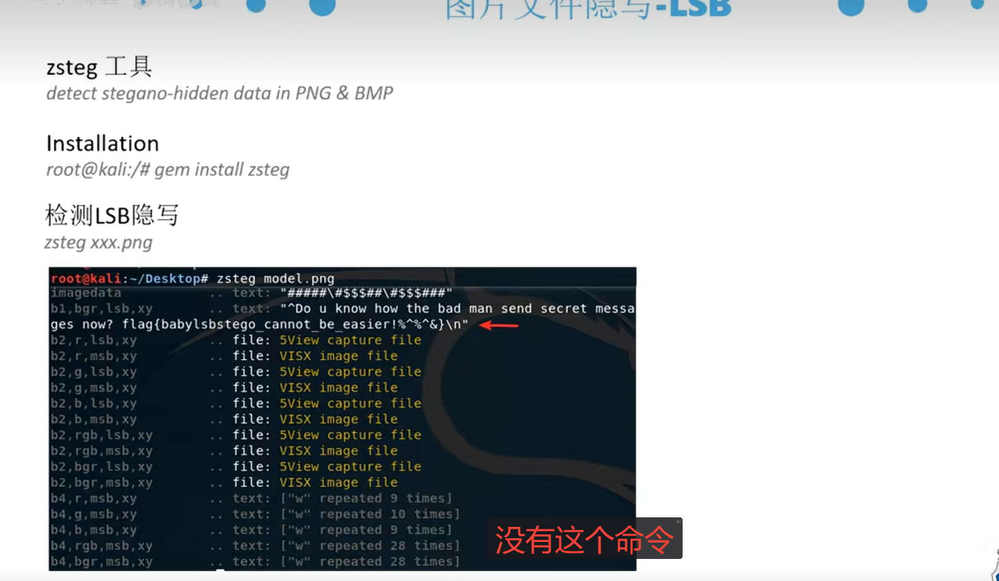
    对于pdf，bmp的
    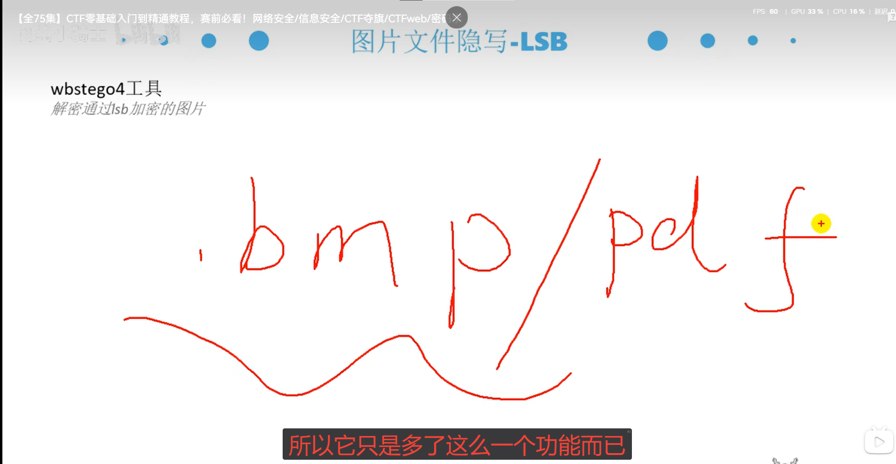
    图片残缺修复
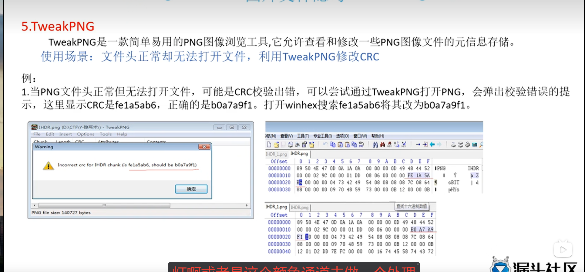

#### PNG图像源文件含义
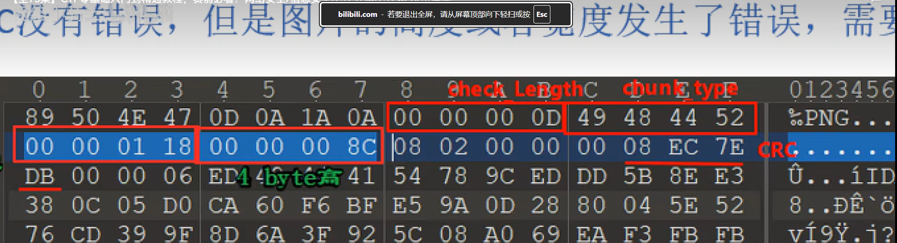
### 图片加密
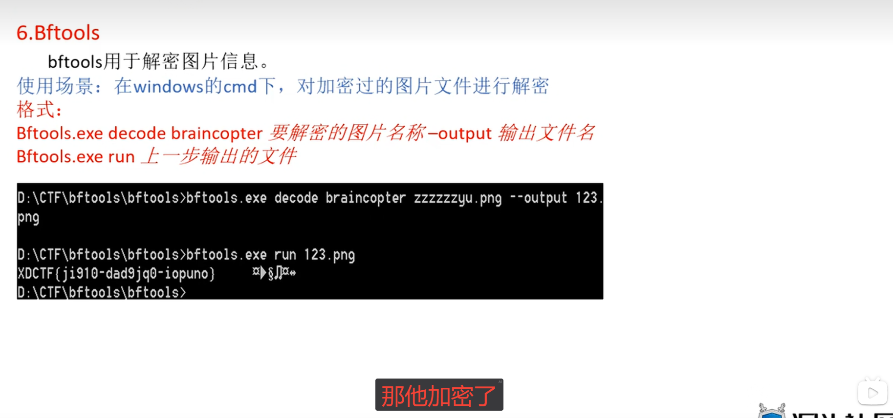
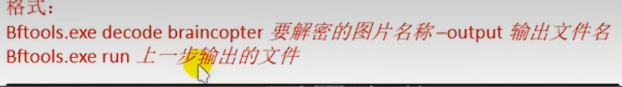
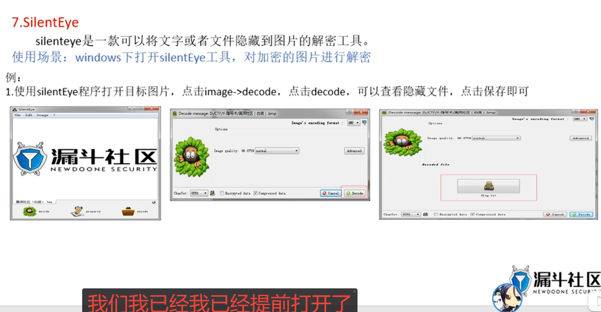
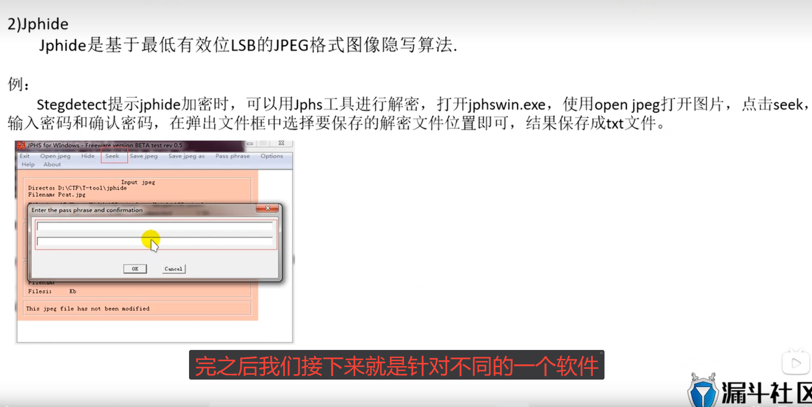
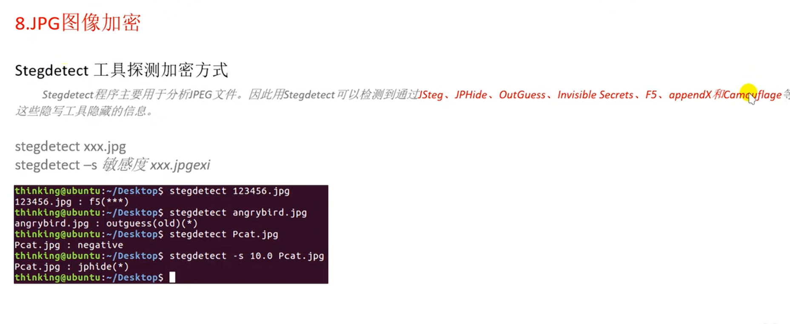
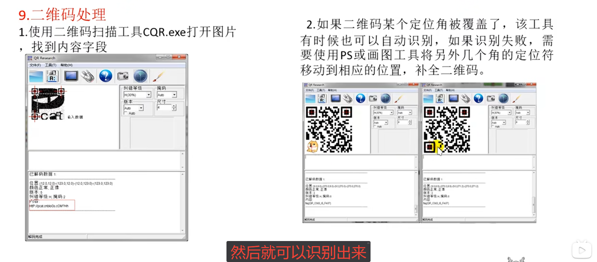
- Stegdetect
- outguess
- Jphide
- F5
### 遇到打开是乱码的用16进制查看器

### 总结

🧭 第一步：通用排查（适用于所有图片）
不管拿到什么图片，先用这几招过一遍，能筛掉一半的题：

看真实类型：file 文件名。如果提示是 PNG 但后缀是 JPG，或者提示是 ZIP、RAR，直接改后缀或按相应格式处理（常有“图种”或修改文件头）.

搜关键字：strings 文件名 | grep -i 'flag\|ctf\|key'。很多简单题直接把 flag 写在二进制数据里。

看元数据（EXIF）：exiftool 文件名 或 exiv2 文件名。常有 Comment 字段、拍摄地点、相机型号里藏 flag。

分离附加文件：binwalk -e 文件名 或 foremost 文件名。看看图片尾部是不是拼接了 ZIP、PNG，提取出来。

十六进制查看：xxd 文件名 | head 或 xxd 文件名 | tail。看头部是否被修改（比如 PNG 头被改了），或者尾部是否有追加数据。

🖼️ 第二步：按后缀精准打击
1. JPG / JPEG 后缀
JPG 是有损压缩，不适合做 LSB 隐写，所以常见的套路是“加密隐写”。

主力工具：steghide / stegseek

解题步骤：

尝试无密码提取：steghide extract -sf 文件.jpg

如果提示需要密码，直接用 stegseek 爆破解密：
stegseek --crack -sf 文件.jpg -wl /usr/share/wordlists/rockyou.txt

如果 stegseek 没结果，尝试 stegseek --seed 文件.jpg 检测是否根本不是 steghide。

其他怪招：outguess、jphide、F5 隐写（需要专门的检测工具，如之前提过的 stegdetect，但成功率低，建议先用 stegseek）。

2. PNG 后缀
PNG 无损压缩，是 LSB（最低有效位）隐写的重灾区，也是 CTF 最爱考的格式。

主力工具：zsteg、Stegsolve、pngcheck

解题步骤：

LSB 扫描：zsteg -a 文件.png。它会列出所有可疑通道，如果看到字符串或 PK 头（ZIP文件头），用 zsteg -E "通道名" 文件.png > output 提取。

图形化分析：运行 java -jar stegsolve.jar，使用 Analyse -> Data Extract 勾选 Red/Green/Blue 的 0 位，看能不能看到清晰的二维码或字符串；或者用 Frame Browser 查看帧（动图）。

结构检查：pngcheck -v 文件.png。如果提示 CRC error（CRC 校验错误），说明宽高被修改过，或者 IDAT 数据块被篡改。

宽高修改（高频考点）：如果图片显示不全，用 Python 脚本爆破/修改 IHDR 块里的宽和高，并修复 CRC 值。

双图对比：两张图片长得很像，大概率是“盲水印”。需要用到 blind-watermark 等脚本或者在线工具。  

3. BMP 后缀
BMP 是未压缩格式，体积大，也常用来做 LSB 隐写。  

主力工具：zsteg、Stegsolve、wbStego
解题步骤：
直接上 zsteg -a 文件.bmp，经常能扫出 LSB 数据。
如果是调色板隐写（Palette-based），需要写 Python 脚本（用 PIL 库）读取调色板顺序，或者用 Stegsolve 的 Colour Palette 功能查看。

有时候是 wbStego 加密，如果 zsteg 没结果，可以尝试用 stegseek（它也支持 BMP）。  

4. GIF 后缀
GIF 是动图，核心考点在多帧和调色板。
主力工具：Stegsolve、ffmpeg、identify
解题步骤：  

分帧：用 ffmpeg -i 文件.gif frame_%d.png 或 convert 文件.gif frame_%d.png 把每一帧切出来，逐一查看是否有隐藏文字或残缺二维码。  

帧时间隐写：有些题目把 flag 的二进制写在了每一帧的延时时间（帧间隔）里。需要用 identify -format "%T\n" 文件.gif 获取每帧延时，然后把 10ms/20ms 转换成 0/1 再转 ASCII。

调色板隐写：同 BMP。

Stegsolve 帧浏览：在 Stegsolve 里用 Frame Browser 可以逐帧查看，非常方便。

## 压缩文件分析

### 伪加密

    如果压缩文件是加密的，或文件头正常但是解压失败，首先尝试文件是否位伪加密  
    zip文件是否加密由标识符显示，再每个文件的目录有一位专门来表示是否加密，将其设置为00表示未加密  
    如果这时候解压成功了，说明是伪加密，否正出错为真加密  
    用16进制编辑器进入后，搜索504B0102，后的第5，6个字符，改成0000  
    rar的话是第24位的尾数改为0，4是加密
### 暴力破解  
    利用ARCHPR工具（F:/CTFtools/Arc）
    已知前几位
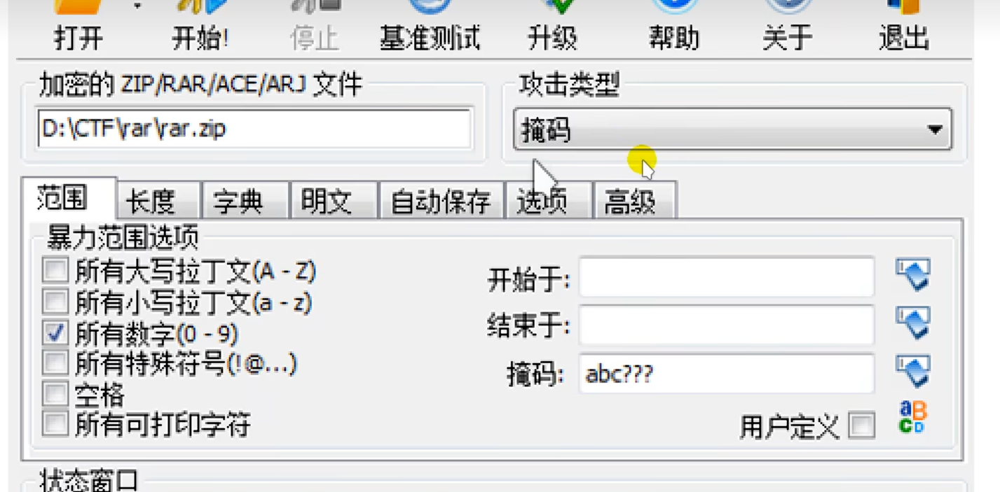

### 哈希对比
    工具zip2John
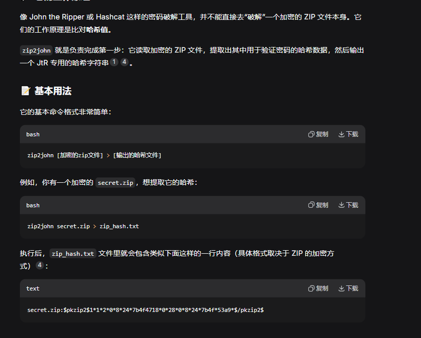
### 明文攻击
    知道加密的zip中的部分明文内容，利用这些内容推测出密钥并解密zip  
    相比于暴力，这种在破解比较复杂的压缩包时效率更高  
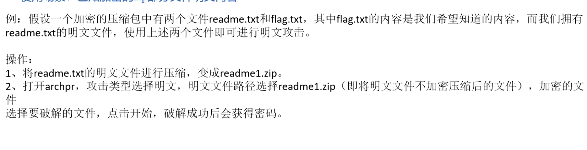
    tips：明文压缩的算法和加密的压缩算法一样

## 流量取证
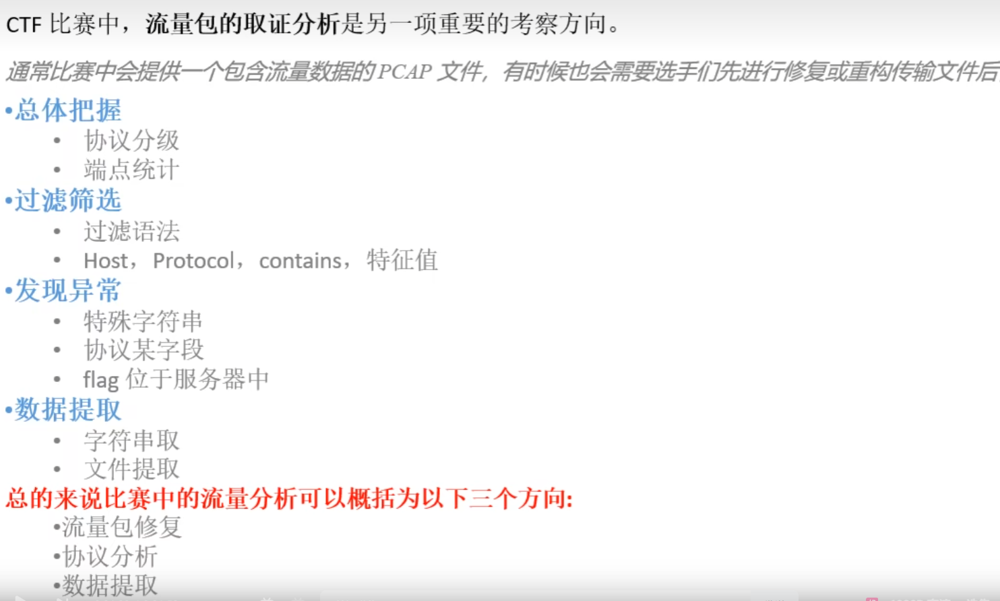
### wireshark

#### 过滤指令
    源ip或者目的ip
```wireshark 
    ip.src eq x.x.x.x or ip.dst eq x.x.x.x  
    ip.addr eq x.x.x.x
```
    过滤http
``` wireshark
    tcp.port eq 80 or udp.port eq 80   
    tcp.dstport == 80 //tcp目的端口为80
    tcp.srcport == 80 //tcp源端口为80
    tcp.port >= 1 and tcp.port <= 80
```
    过滤协议tcp/udp/arp/icmp
    过滤MAC
```wireshark
    eth.dst == xx:xx:xx:xx:xx:xx 过滤目标
```
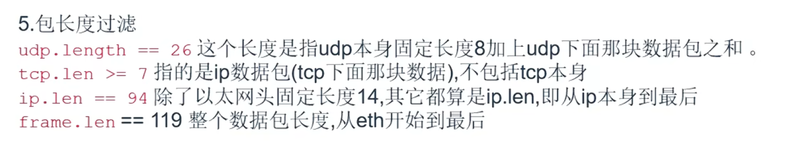
    http模式过滤
    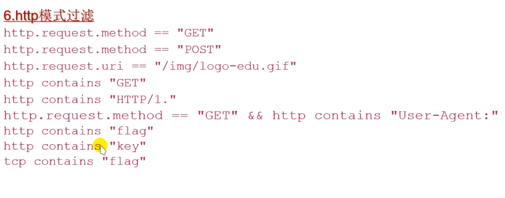
```wireshark
    http.request.method == "GET"
    http.request.method == "POST"
    http.request.uri ==" "
    http contains "GET"
    http contains "HTTP/1."
    http.request.method == "GET" && http contains "User-Agent:"
    http contains "flag"
    http contains "key"
    tcp contains 'flag'
```

#### 解题过程

    拿到pcap后先用wireshark分析数据报的组成部分  
    主要是IPV4的  
    如果是http的部分，文件是分块传输的，要把他们合并起来
    根据数据包的特征筛选  
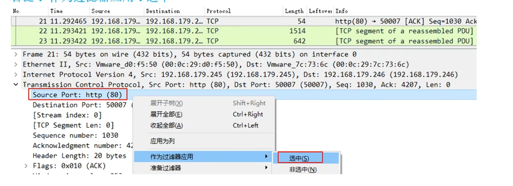
    流汇聚
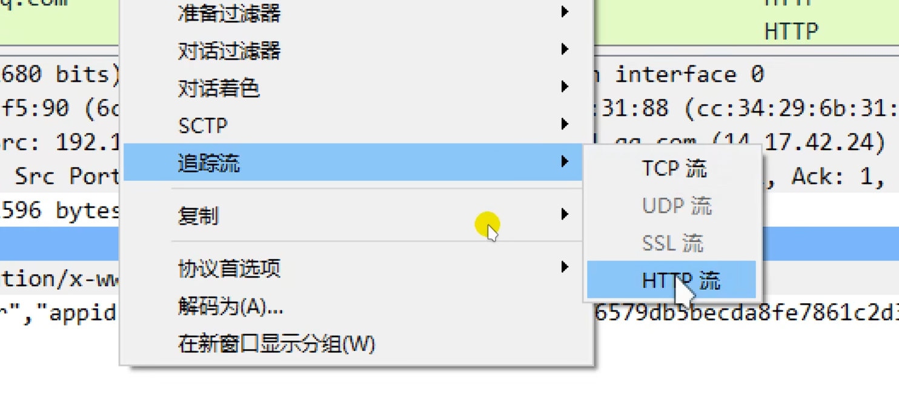
    在关注的数据报中进行流汇聚可以还原成数据  
    http流中包含重要内容：  
    1，html中直接包含重要信息  
    2，上传或下载文件中包含文件名和hash，常用post请求上传  
    3，一句话木马，post请求，内容包含eval，用base64加密
    wireshark里面可以进行数据提取自动提取http传输的文件内容  
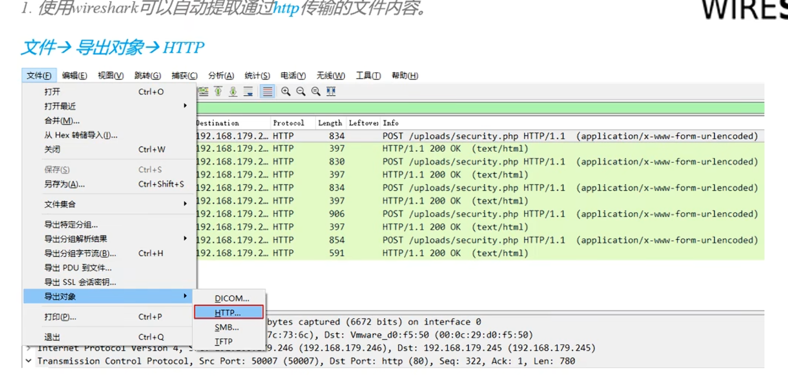
    导出单个分组的字节流  
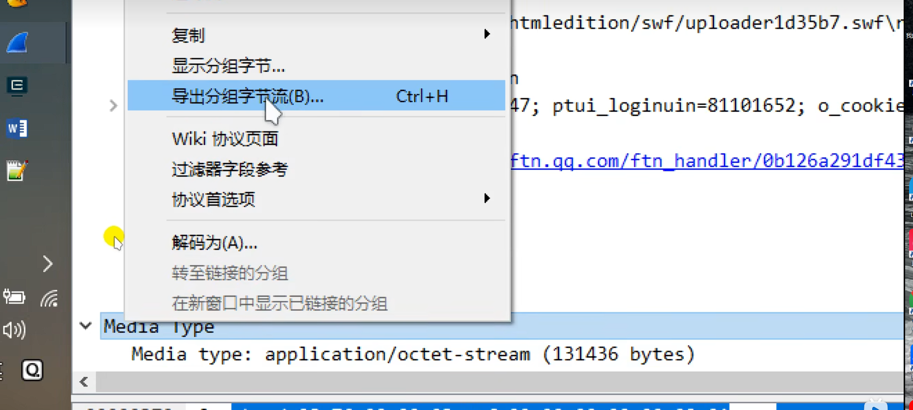
#### WIFI流量的分析
    kali中利用aircrack-ng xxx.cap进行无线密码破解  
    wifi加密WPA， WEQ ， WPA2  
    aircrack-ng xxx.cap -w pass.txt  
#### USB流量分析
    在线网址 tools.qsnctf.com/misc/usb_flow_analyze   
    USB协议数据部分在Leftover Capture Data中  
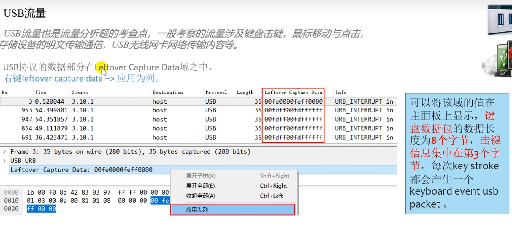 
    键盘数据包的长度为8个字节，击键星系在第三个字节，而每次key stroke都会产生一个keyboard event usb packet  
    提取data方法  
    1，导出为CSV（不好用）
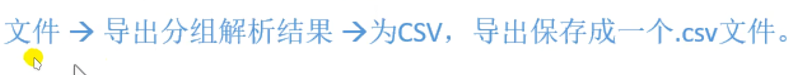
    2，tshark，将lcd的数据单独复制出来
```bash
    tshark -r usb1.pcap$目的文件$ -T fields -e usb,capdata > usbdata.txt$写出文件$
```
#### COTP协议
    COTP  
    可以理解为基于TCP的工控TCP，主要有五种类 型：  
    CR Connect Request (0x0e)——握手，发送方发送  
    CC Connect Confirm (0x0d)——握手，接收方发送  
    DT Data (0x0f)——传正常数据  
    UD User Data (0x04)——少见，传自定义数据  
    ED Expedited Data (0x01)——少见，传紧急数据  
    CR和CC只在建立连接时由双方发送，发起方发送CR，被动方发送CC，后续数据主要走DT。因为协议类似于TCP，较为底层，所以没有其他比较有用的协议字段可供解题；同样因为COTP较为底层，用来出题的概率较小，就像用纯TCP出题的概率一样  


    http://www.efittech.com/hxdec.aspx
    汉信码
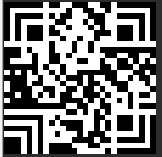

    密文有斜杠可能是rabbit加密
    解密网址
    www.sojson.com/encrypt_rabbit.html

    PNG头文件base64加密后  
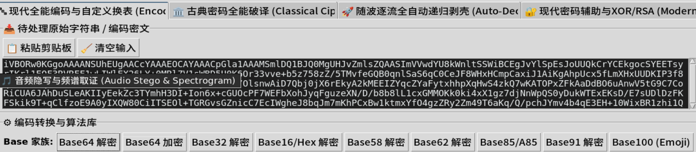


# MISC真题演练 
## bugku

### 这是一张单纯的图片
    #&的大概率时html编码  
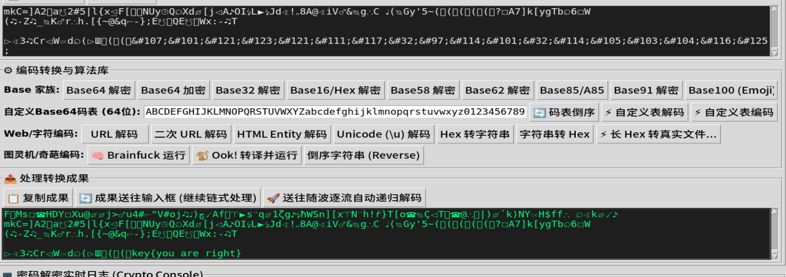


### linux

    直接拖入工具台  
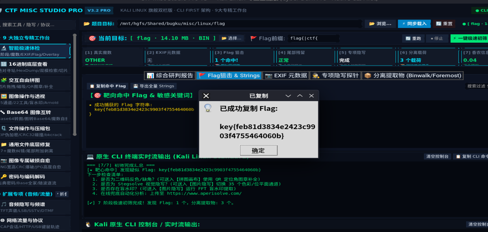

### 隐写
    png高度被修改
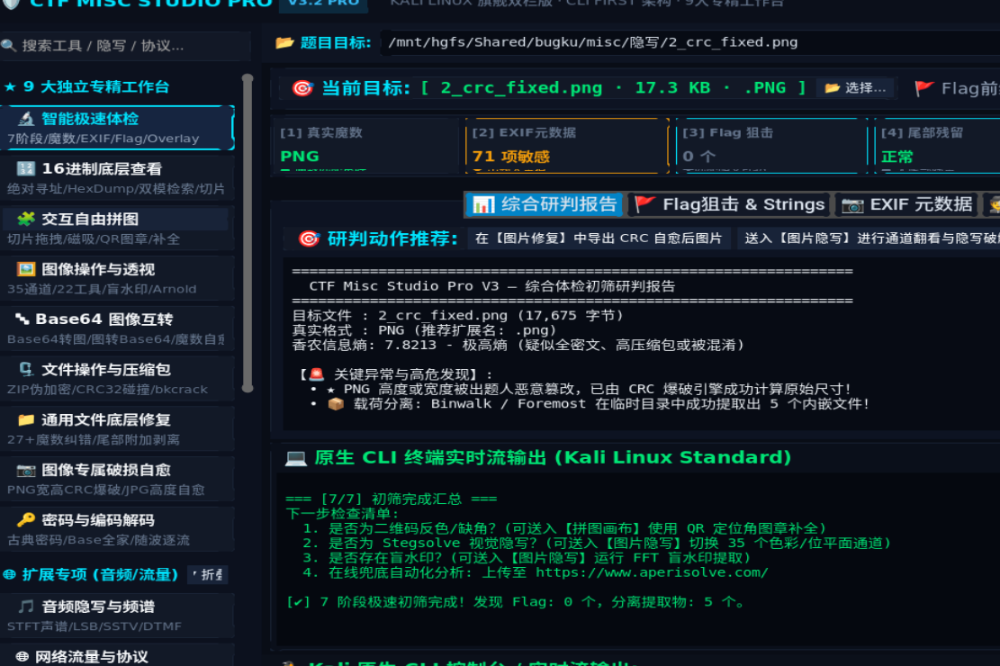

### talent
    在工具台中过滤flag
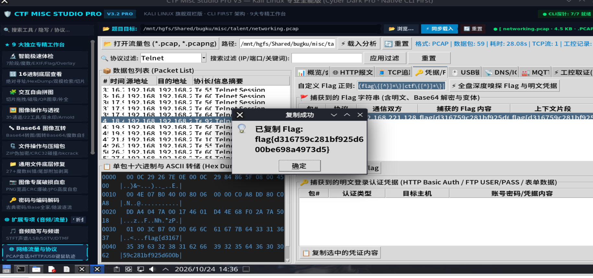


### 眼见非实


    发现是zip，改一下啊后缀  
    解压，一个文件一个文件找  
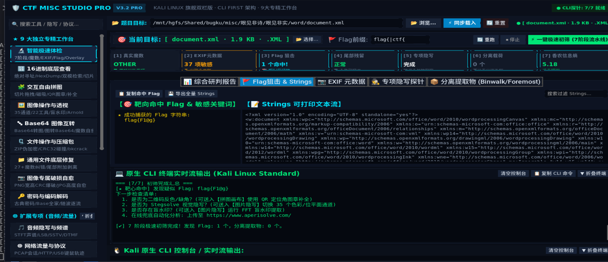

### 多种发发解决
    工作台中发现是base64编码的，转一下图片

    转出来是二维码，扫一下


### linux2
    导入工作台，直接得出


### 又一个单纯图片
    放入工具台发现又隐含文件  


### 闪的好快  
    拿到发现是gif   
    在工作台中分离，发现有18个二维码
    进入工作台批量扫码  


### 宽带用户  
    导入工作台，进入路由取证  
    搜索username  


### 逆向入门  

    导入工作台，查看16进制发现是base64的编码  
    转图像  


### spilt_all  

    导入工作台，查看16进制发现有89a，判断是gif，利用vim编辑，得到gif   D
    再将切片分离并拼接  

### 薛定谔的猫
    打开16进制擦看起，发现有py代码

    导出，运行得到flag.txt

### 图穷匕见
    图片尾部有附加数据，分离出来  
    转ascii码发现是二维坐标，导入一下  
    转化位二位码


### 0和1的故事

    载入工作台发现，全是01  
    转化为二维码，补全一下


### 赛博朋克  

    题目是一个zip加密的  
    伪加密修改一下  
    发现里面有个txt,其实是png  
    修改之后查看隐写


### 隐写2

    题目是个png，放入工作台发现有尾巴  
    提取一下

    提取之后发现是个zip
    


### LOOK
    放入工作台发现可以是zip

    解压一下    
    发现是bmp，考虑隐写，启动zsteg  
    找到了  


### 选择跳跃

    mps隐写，密码是syclovergreek  


### ping
    送入工作台发现
    flag{dc76a1eee6e3822877ed627e0a04ab4a}


### 蹭网密码


### usb流量  
    放入工作台  
    进入usb专项  


### 普通的二维码  
    bmp，考虑一下隐写和尾部  

    有点像8进制  
    转化为ascii


### 简单取证  


