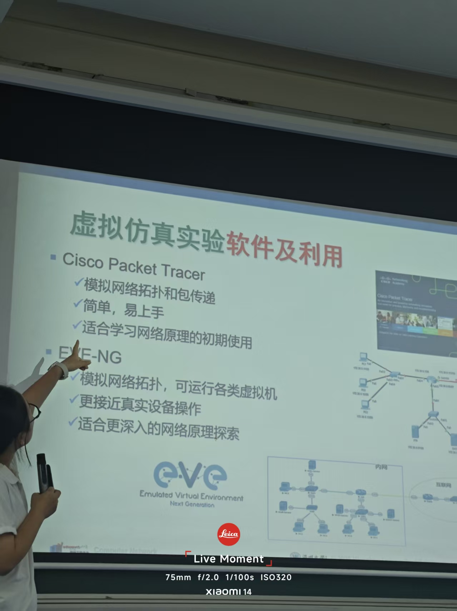
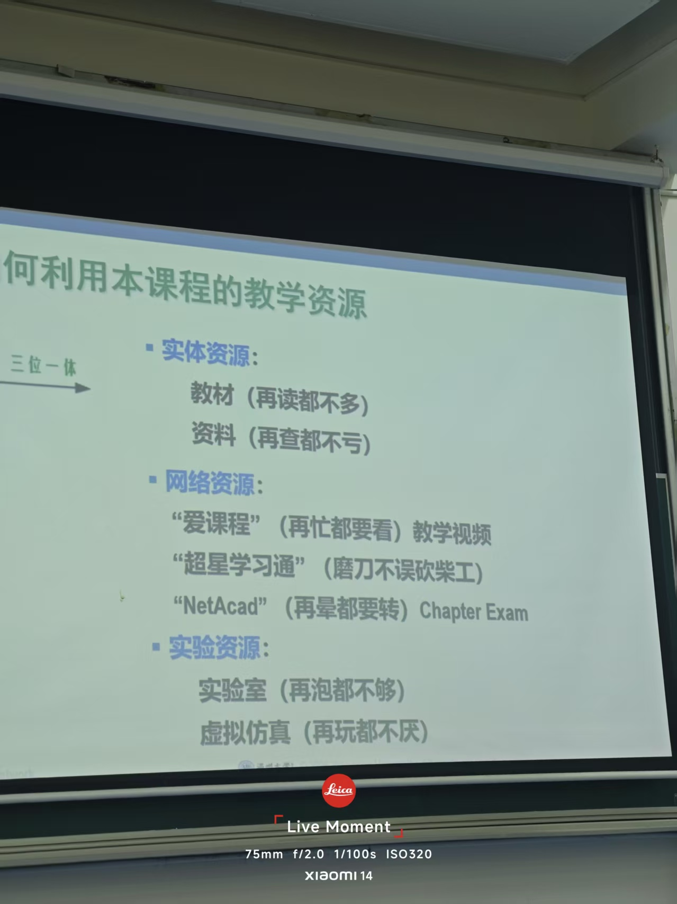
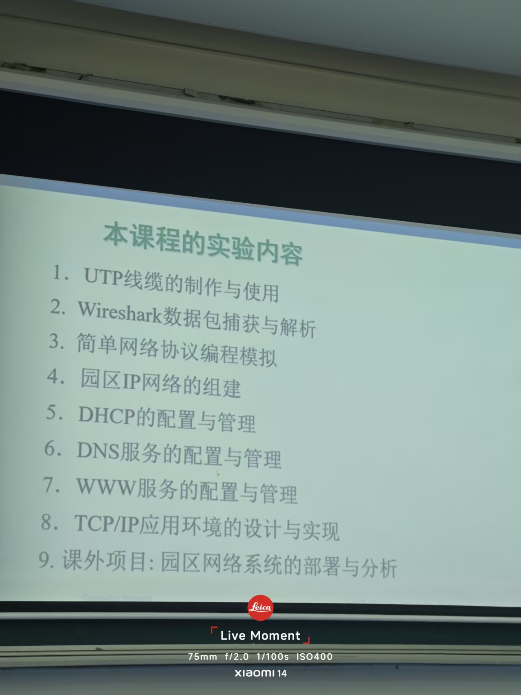

# Nico 的学习博客

温州大学 25 网工。这里按知识领域整理课程笔记、实验记录与学习资料。

> 本站已于 2026-11-05 完成目录重构：笔记统一归入 `docs/` 七大分类，图片、课件、源码、其他附件归入 `assets/` 分层目录。原始版本完整保存在 `D:/library/_backup/20261105/Blog-full/`。

## 内容导航

| 分类 | 内容 |
| --- | --- |
| [01 计算机基础](/docs/01-计算机基础/计算机网络/计算机网络.md) | 计算机网络、计算机组成原理 |
| [02 编程与开发](/docs/02-编程与开发/C/C语言格式转换符号速查.md) | C 语言、Web / 小程序 |
| [03 Linux 与网络安全](/docs/03-Linux与网络安全/CTF/CTF-入门与题型总览.md) | 网络工程、CTF |
| [04 算法与数学建模](/) | 待补充 |
| [05 项目实践](/) | 待补充 |
| [06 学习记录](/docs/06-学习记录/待整理/计算机网络-test1-拓扑布局.md) | 待整理的零散记录 |
| [07 资源与附件](/docs/07-资源与附件/资源索引.md) | 课件、源码、图片索引 |

## 本地运行

```bash
D:\Blog> docsify serve .
```

## 常用命令备忘

```bash
git add .
git commit -m "更新笔记"
git push
```

## 服务器地址备忘

```
大徐 ftp：ftp://10.5.12.200/
微信小程序：ftp://10.132.219.5:303/
小徐：10.132.219.5:8380
葛一粟：ftp://10.132.219.5:5883/
```

[CISCO 网院](https://www.netacad.com/) · [GitHub 仓库](https://github.com/nicooccc/my_blog)

## 第一段代码

初学 C 时写下的测试程序，留作纪念：

```c
#include<bits/stdc++.h>
using namespace std;
int main()
{
    int a;
    cin >> a;
    cout << a;
}
```




