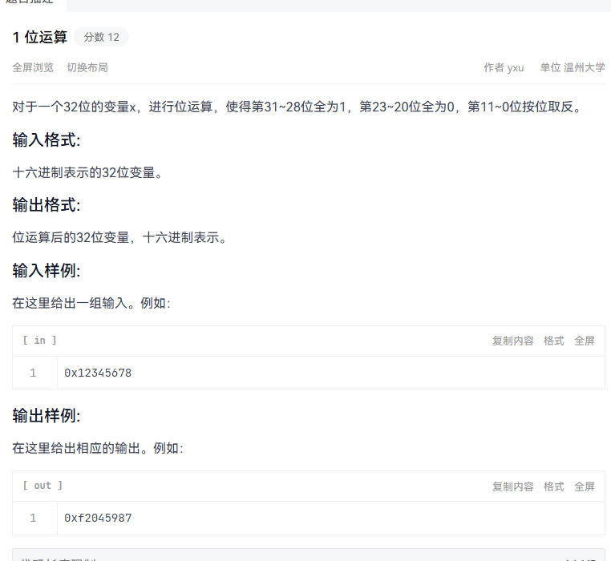
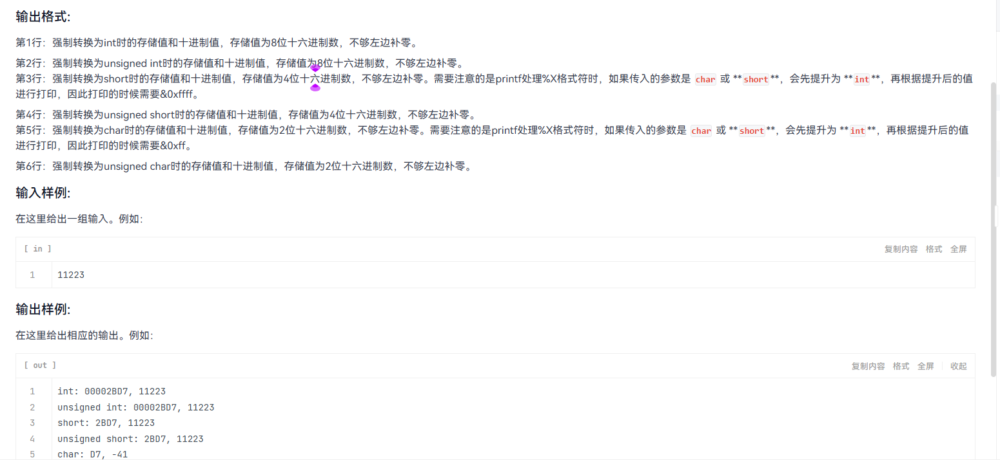

<!-- synced-from-vault: 02-计算机基础/计算机组成原理/位运算与类型转换实验.md | updated: 2026-11-06 -->
# 位运算与类型转换实验

<!-- guide-start -->
> **本篇定位**：实验三的原始代码记录——十六进制位运算，以及 C 语言各整数类型之间的转换输出验证。
>
> **学习重点**：先自己算出每段代码的输出，再对照截图；核心是「位模式不变，解释方式随类型而变」。
>
> **自测**：① 三段位运算组合后为什么得到那个十六进制值？② 强制类型转换改变了位模式吗？③ `unsigned` 与 `signed` 打印同一位模式时结果为何不同？

---

<!-- guide-end -->

## 一、实验目标

1. 用 `|`、`&`、`^` 组合修改一个 32 位无符号整数的指定位，观察十六进制输出。
2. 把同一个 `int` 输入分别强制转换为 `int` / `unsigned int` / `short` / `unsigned short` / `char` / `unsigned char`，对照「位模式」与「按类型解释后的数值」。
3. 统计一个无符号整数中置 1 的位数（popcount）。

## 二、实验环境

- 原笔记未记录编译器与运行环境；代码含 `<bits/stdc++.h>` 与 `using namespace std;`，属 **GNU C++** 写法，不是标准 C。
- 同库 [C 语言格式转换符号速查](../../02-编程与开发/C/C语言格式转换符号速查.md) 记录了本机实测环境（Windows + mingw64 gcc 15.2.0，x86-64，`sizeof(int)=4`），可作参考；本实验环境**待补确认**。

## 三、核心代码与操作过程

### 3.1 位运算组合

读入一个十六进制数，依次置位、清位、取反，最后按 `%08x` 输出。



```cpp
#include <bits/stdc++.h>
using namespace std;

int main()
{
    unsigned int a;
    if (scanf("%x", &a) != 1)
    {
        return 0;
    }
    a |= 0xF0000000u;   // 高 4 位置 1
    a &= 0xFF0FFFFFu;   // 第 20–23 位清 0
    a ^= 0x00000FFFu;   // 低 12 位取反
    printf("0x%08x\n", a);
    return 0;
}
```

> 三个掩码互不重叠的低 12 位与高 4 位操作可分开推算；`%08x` 的 `0` 是补零标志、`8` 是最小字段宽度（详见格式符速查笔记）。

### 3.2 同一输入的类型转换输出



```cpp
#include <bits/stdc++.h>
using namespace std;

int main()
{
    int x;
    if (scanf("%d", &x) != 1) return 0;

    int vi             = (int)x;
    unsigned int vu    = (unsigned int)x;
    short vs           = (short)x;
    unsigned short vus = (unsigned short)x;
    char vc            = (char)x;
    unsigned char vuc  = (unsigned char)x;

    printf("int: %08X, %d\n",
           (unsigned int)((unsigned int)vi & 0xFFFFFFFFu), x);
    printf("unsigned int: %08X, %u\n",
           (unsigned int)(vu & 0xFFFFFFFFu), vu);
    printf("short: %04X, %d\n",
           (unsigned int)((unsigned int)vs & 0xFFFFu), (int)vs);
    printf("unsigned short: %04X, %u\n",
           (unsigned int)((unsigned int)vus & 0xFFFFu), (unsigned int)vus);
    printf("char: %02X, %d\n",
           (unsigned int)((unsigned int)vc & 0xFFu), (int)vc);
    printf("unsigned char: %02X, %u\n",
           (unsigned int)((unsigned int)vuc & 0xFFu), (unsigned int)vuc);
    return 0;
}
```

> 原笔记第二段 `printf` 起有多余的 4 空格缩进，此处统一；**运算逻辑与掩码一字未改**。
> 打印窄类型时先 `& 0xFFFF` / `& 0xFF`，是为了消掉整型提升带来的高位；原因见 [C 语言格式转换符号速查](../../02-编程与开发/C/C语言格式转换符号速查.md) 第 9 节。

### 3.3 统计 1 的个数

原笔记此处只写了「统计 1」一行文字，代码如下：

```cpp
#include <bits/stdc++.h>
using namespace std;

int main()
{
    unsigned int x;
    cin >> x;
    cout << popcount(x) << endl;   /* 待验证：见下方说明 */
    return 0;
}
```

> **注意** · 待验证（2026-11-06）
> 原代码直接调用 `popcount(x)`，但标准 C++ 直到 **C++20** 才提供 `std::popcount`（需 `<bit>` 且用 `std::` 限定）；GNU 扩展对应的是 `__builtin_popcount`。
> 原笔记未记录编译选项与实际运行结果，**不臆测**：请在你的环境里确认该函数来源后再运行。原始代码已按原样保留。

## 四、执行结果

结果以原始截图为准，本笔记不重写实验数值：

- 3.1 输出截图：`image-42.png`（上）
- 3.2 输出截图：`image-43.png`（上）

> **提示** · 待补充
> 建议把两张截图里的输入值与打印结果抄成表格，并写明「为什么是这个值」，这份实验记录才算完整。

## 五、问题与排查

- **`<bits/stdc++.h>` 不是标准头文件**：只在 GNU 编译器下可用，跨平台请改包含 `<cstdio>` / `<cstring>` 等具体头。
- **`printf` 与转换字符必须类型匹配**：`%X` 应传 `unsigned int`；窄类型先提升再打印（见格式符速查笔记第 10 节坑清单）。
- **`popcount` 的可用性**：见 3.3 的待验证提示。

## 六、知识总结

- 位运算改的是**位模式**；强制类型转换改的是**同一位模式的解释方式**，不额外分配新数据。
- 有符号 → 无符号：位模式不变，按无符号重新解释（补码全 1 从 `-1` 变成 `4294967295`）。
- 宽 → 窄：直接截断高位；窄 → 宽：无符号零扩展、有符号符号扩展。
- 打印时想看「真实的存储位模式」，要么先 `& 0xFF` / `& 0xFFFF`，要么用 `%hhX` / `%hX`。

## 相关笔记

- 计算机组成原理知识地图
- 总知识地图
- [计算机系统基础 · 1-3 章复习](计算机系统-1-3章复习.md)
- [C 语言格式转换符号速查](../../02-编程与开发/C/C语言格式转换符号速查.md)

<!-- vault-sync: 由 D:/library/nico 自动同步，请勿在博客侧手工编辑 -->
