<!-- synced-from-vault: 02-计算机基础/计算机网络/网络基础概念.md | updated: 2026-11-06 -->
# 思科网院-网络概念

<!-- guide-start -->
> **本篇定位**：思科网院课程的概念笔记，从家庭/企业网络、冗余与可扩展性，到 QoS、云类型与基础设备配置。
>
> **学习重点**：以「为什么这样设计」为主线，特别注意可扩展性、冗余、服务质量三者之间的取舍。
>
## 本篇导航

- 家庭Internet连接
- 企业Internet连接
- 冗余网络
- 可扩展性
- 网络安全
- 服务质量
- 云类型
- 网络安全解决方案
- TEST
- 交换机和终端设备的基本配置

> **自测**：① 冗余接口与分组交换各自解决什么问题？② QoS 在什么场景才真正必要？
>
> **提示** · 截图型笔记 · 待补文字
> 本篇多数小节只有课件截图，文字是课堂速记。已完整保留全部原图与原始记录；建议后续对照截图把「家庭/企业连接、可扩展性、网络安全、云类型、安全解决方案」等节的结论补成文字。

---

<!-- guide-end -->

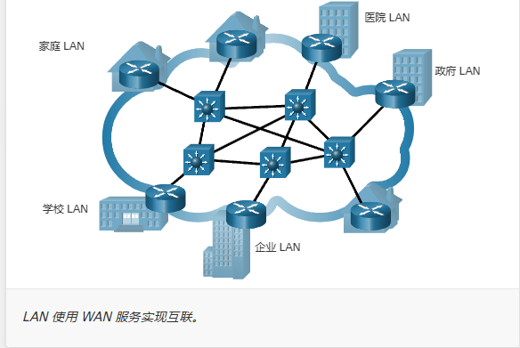

## 家庭Internet连接

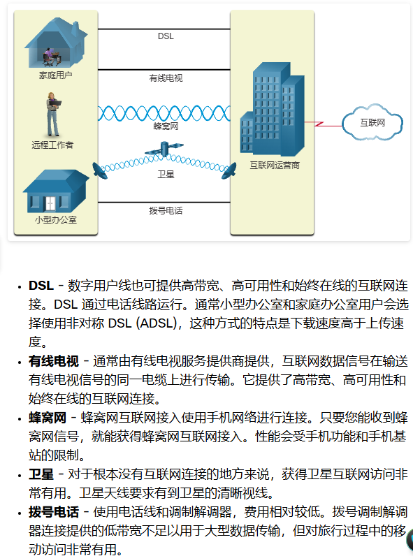

## 企业Internet连接

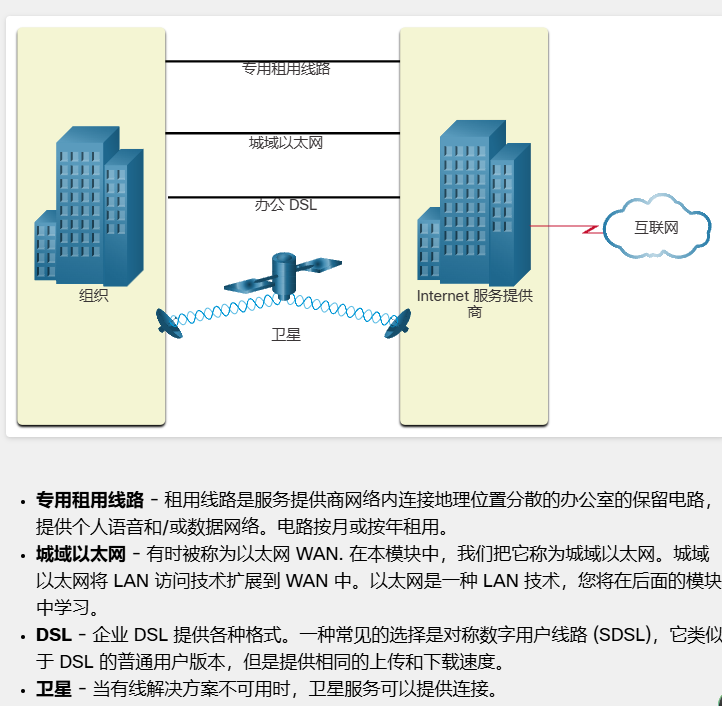

## 冗余网络

通过冗余接口以及分组交换来实现

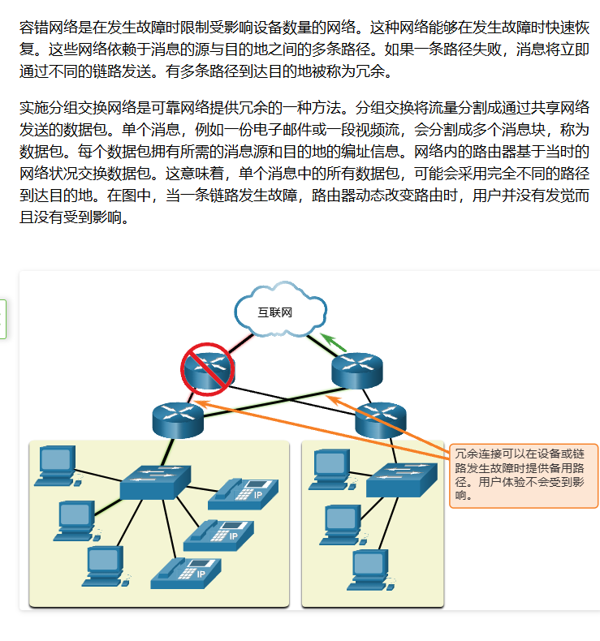

## 可扩展性

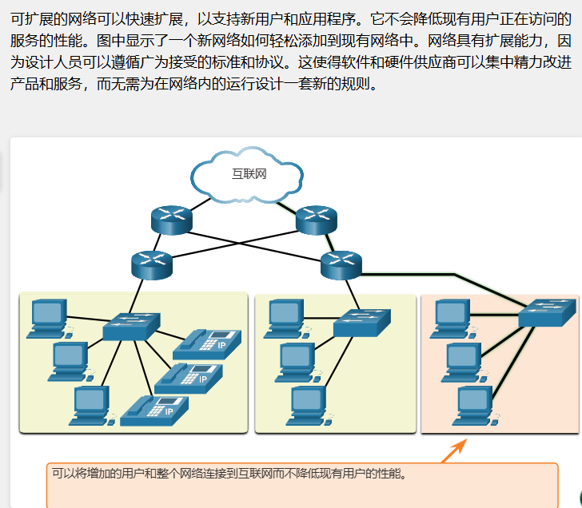

## 网络安全

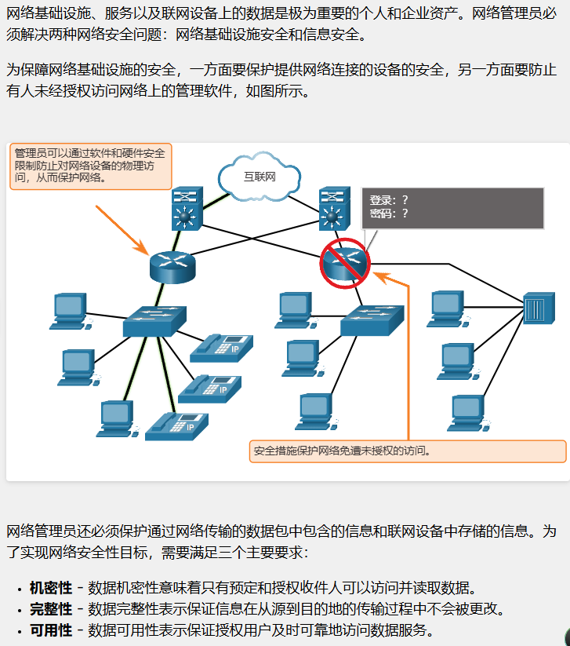

## 服务质量

位/秒（bit/s 或 bps）；**1 Byte = 8 bits**（大写 Byte 是字节，小写 bit 是位）

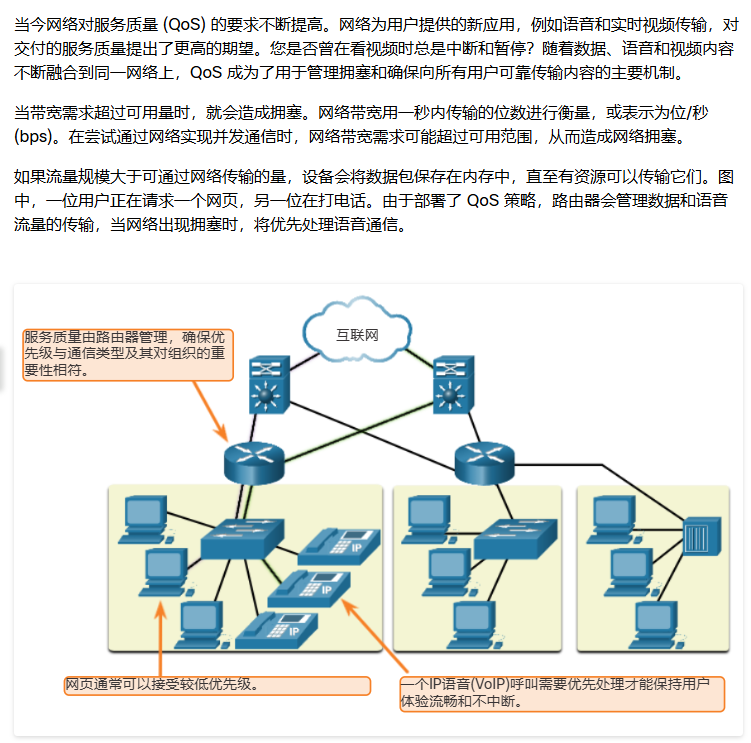

## 云类型

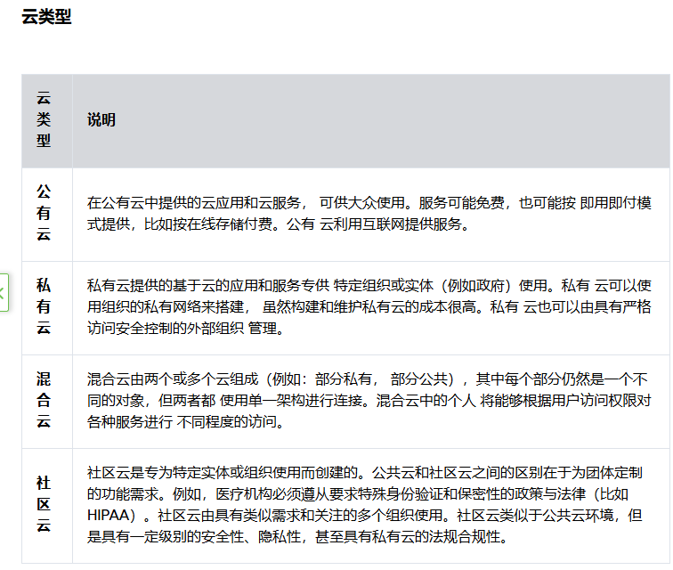

## 网络安全解决方案

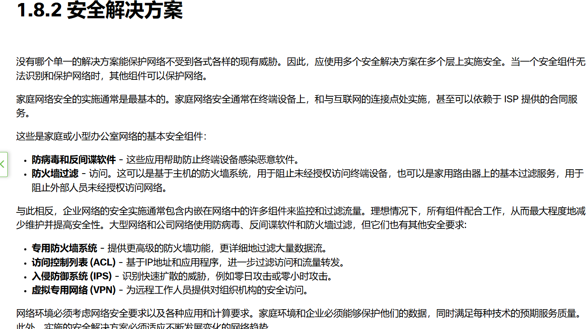

## 课堂小测（TEST）

问题一

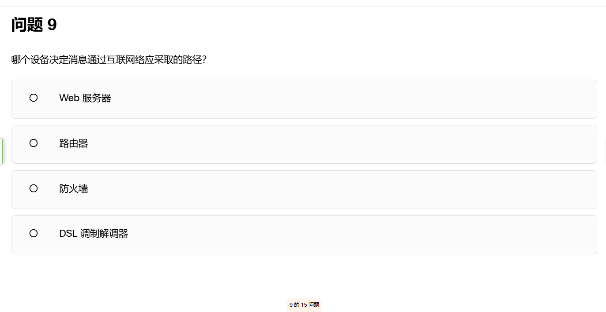

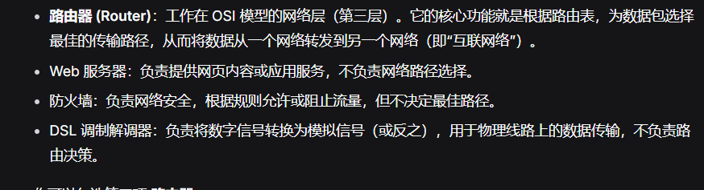

BYOD（Bring Your Own Device）

## 交换机和终端设备的基本配置

### 访问方式

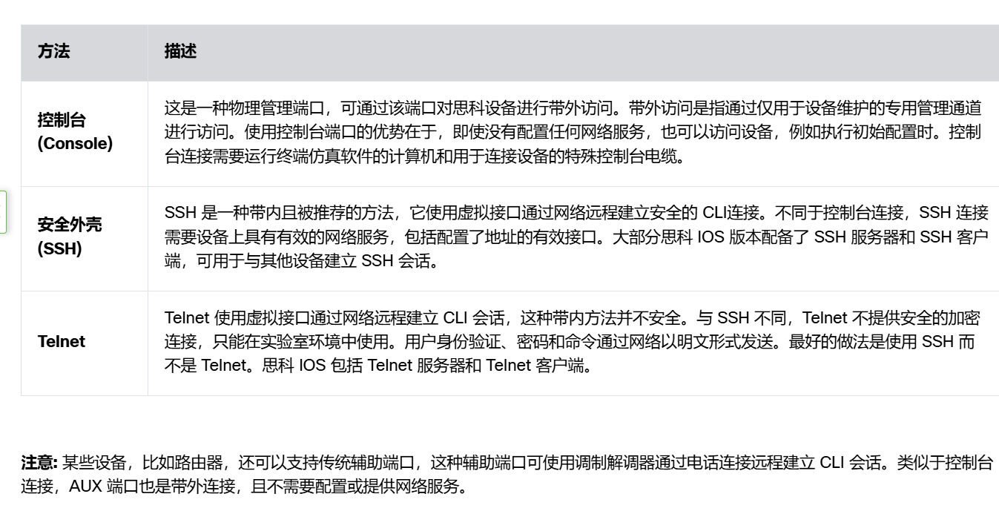

### 命令格式

- 用户EXEC模式（仅查看，访问有限的局部监控指令）
- Switch>
- Router>
- 特权EXEC模式（允许所有指令）

[第一次思科作业](../../03-Linux与网络安全/网络工程/Cisco-设备访问控制与密码验证.md)

## 相关笔记

- 计算机网络知识地图
- [计算机网络](计算机网络体系结构.md)
- [Cisco 设备访问控制与密码验证](../../03-Linux与网络安全/网络工程/Cisco-设备访问控制与密码验证.md)
- 总知识地图

<!-- vault-sync: 由 D:/library/nico 自动同步，请勿在博客侧手工编辑 -->
