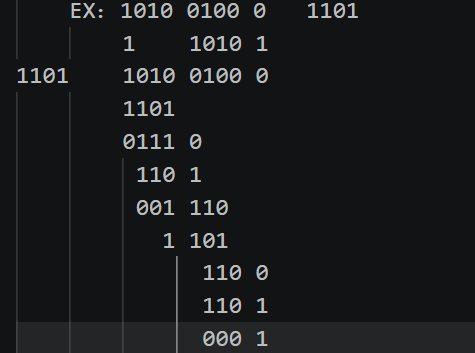
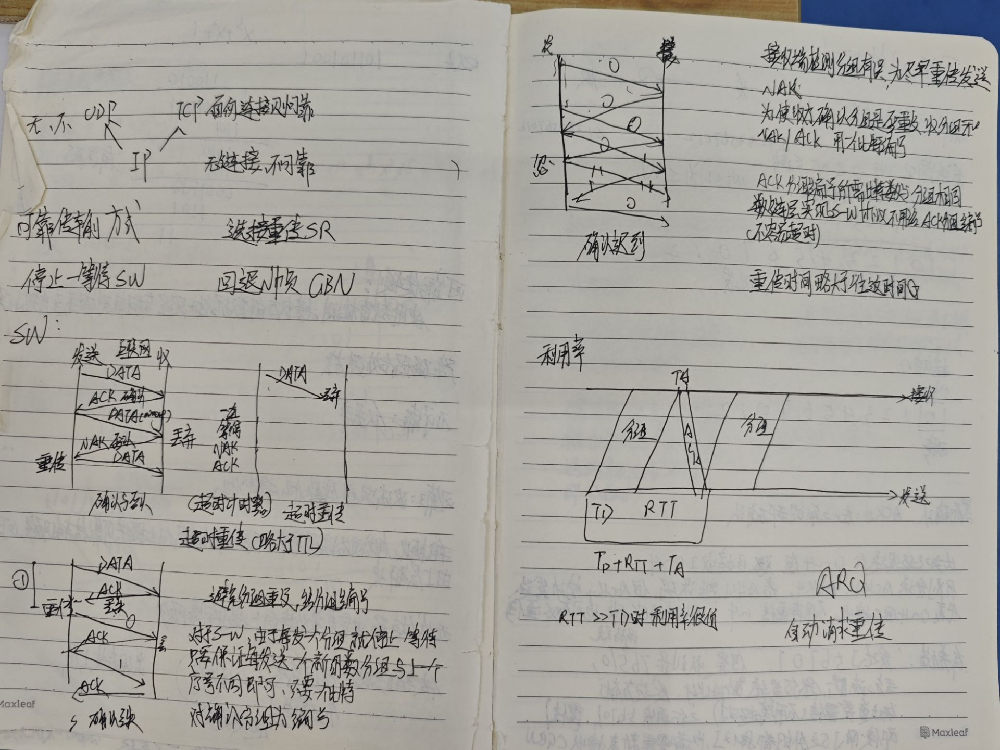
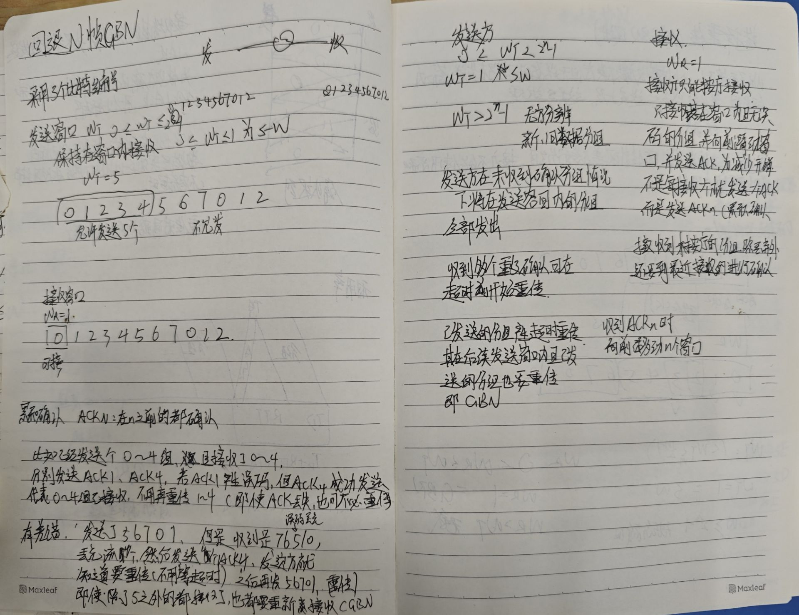
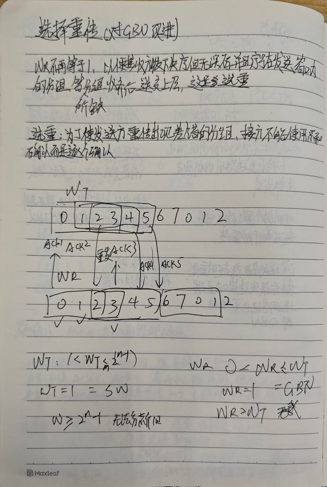
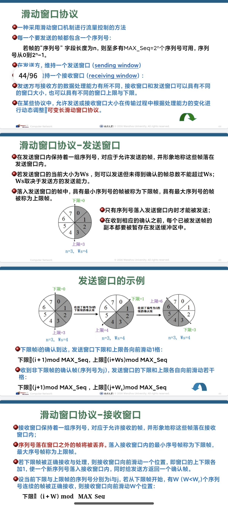
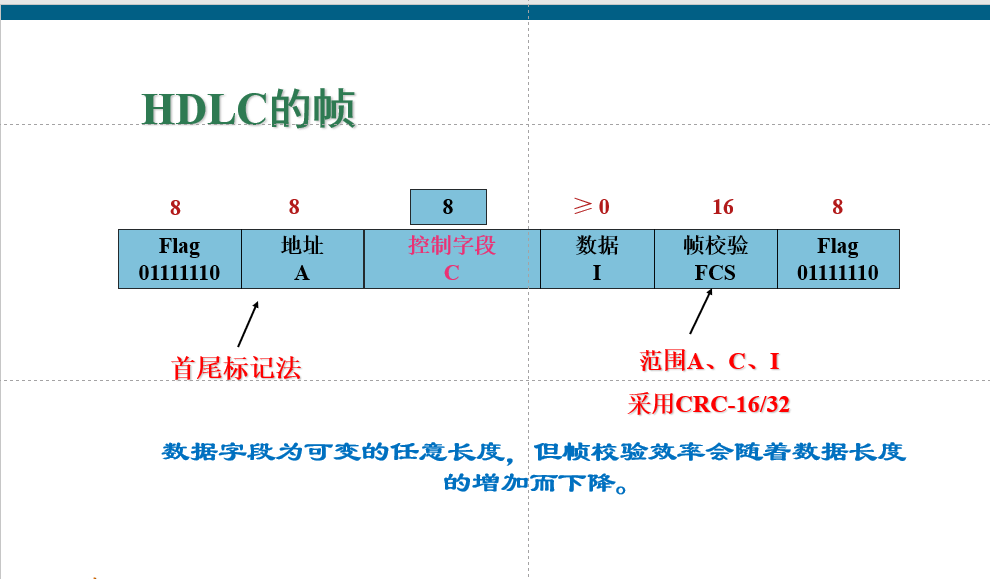
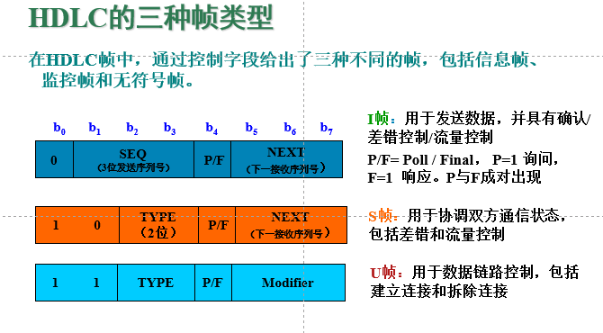
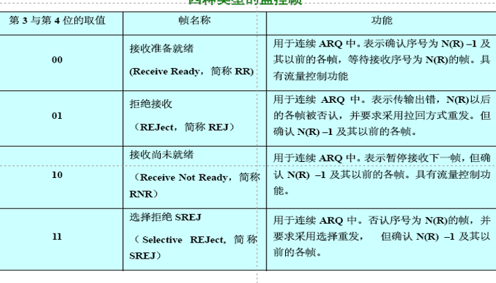
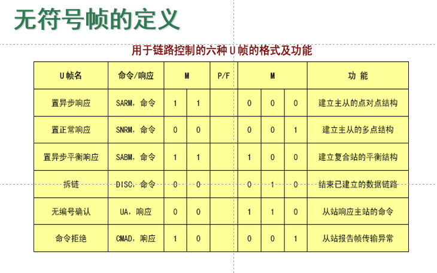

<!-- synced-from-vault: 02-计算机基础/计算机网络/计算机网络体系结构/数据链路层.md | updated: 2026-11-11 -->
# 数据链路层

> **摘要** · 章节定位
> 差错控制、封装成帧、可靠传输、流量控制、HDLC
> 所属：[计算机网络体系结构](../计算机网络体系结构.md)

## 差错控制

### 纠错码

发现误码并纠错

#### 海明码

- 长度为2^k - 1：7， 15
- 2的幂次位空出
- 其他位用信息位填充
- 空出的位，分别校验2^p次跳2^p次  （p为第几个汉明码的位子）
- 偶校验
- 校验判断一个出错将错误的检错位的位数相加得到哪一位出错

#### 线性码

- 任意2个许用码组仍是
- 码间的最小距离等于非零码的最小码重
- k个信息位，r个冗余位，构成n=k+r个码
- 2^r >= n + 1  (错一位加上全对的情况)
- 码重代表纠错能力

### 检错码

发现误码并请求重发

#### 奇偶校验码

- 通过FCS来控制某些位置上的0或1的数量是奇偶个
- 垂直奇偶校验
- 能检测出每列中所有奇数位的错，不能检错偶数个
- 水平垂直校验

#### CRC（循环冗余校验码）

- 信息位，冗余位，生成多项式
- 生成多项式 G(x) 的最高次幂 = 冗余位位数 r

K越大，成本越多

## 封装成帧

- Ethernet V2（DIX）帧格式
- `| 目的地址 6B | 源地址 6B | 类型 2B | 数据 46–1500B | FCS 4B |`
- 「类型」字段标识上层协议（如 `0x0800` = IPv4）；帧承载的是 **IP 数据报**，不是 UDP 报文

> **提示** · 已修正（2026-11-06）
> 原帧示意把「类型」写成「类」、把载荷写成 UDP，此处按 Ethernet V2 改正。
- PPP帧

> 0    0    0   00   ---------------  00    0

- 标志 地址 控制 协议  UDP             FCS  标志
- 帧头帧尾包含重要控制信息
- MAC帧在进入物理层会加上前导码

### 帧定界

#### 字符计数法

- 在帧首部标明帧的字符长度，接收方根据这个计数值来确认帧的结束和下一个开始
- 优点：简单
- 缺点：一旦帧有问题，错误扩大

#### 带字符填充的首尾界符法

- 用‘DLE STX’来标识开头
- 用‘DLE ETX’来标识结尾
- 当数据中出现 DLE 时，在前面加一个DLE
- 接收方遇到两个DLE的时候删去一个
- 优点：较可靠
- 缺点: 数据中DLE多时冗余dle太多

#### 带位填充的首尾标志法

- 用0111 1110作为开始和结束
- 在数据中遇到连续5个1的添加0
- 接收方遇到5个1删去0

#### 物理层编码违例法

利用物理层非0，1的编码来作为标志

## 可靠传输

### SW（stop and wait） 停止等待协议

超时会重复发送

### GBN（回退N帧协议）

- 发送方窗口M
- 接收方窗口1
- 发送NAK后，发送窗口不移动，将没有接收到ACK的分组重发

### SR（选择重传协议）

## 寻址

利用MAC地址来区分

## 链路管理

### 有确认面向连接

适用于通信质量差的

### 有确认无连接

### 无确认无连接

通信质量好的

## 流量控制

### SW协议

### 滑动窗口

- 序列号k位
- 发送窗口要向接收窗口靠齐

## HDLC

### 数据传送

- 正常响应
- 主站可随时发送给从站
- 从站只有在主站发送 poll 后才能发给主站

### 帧

#### 控制字段

##### I帧：用于发送数据，并具有确认/差错控制/流量控制

##### 监控帧：差错控制和流量控制

##### U帧：数据链路控制

## 设备以及帧转发

设备也可以对信号进行放大整形

### 网卡

MAC位48bit，6位字节x

### 网桥（查MAC表转发，类似于SWitc）

- 基于MAC地址过滤和转发帧，能隔离冲突域，但不能隔离广播域
- 现在很少单独见集成到交换机中
- 扩展网络，定向转发，减少冲突

### 帧转发

帧中的MAC地址是单播地址

·   在相同网路中不会转发
·   在表中没有会忽略
·   有的会定向转发

## 相关笔记

- [↑ 返回总览：计算机网络体系结构](../计算机网络体系结构.md)
- [← 上一章：物理层](物理层.md)
- [下一章：以太网 →](以太网.md)
- 计算机网络知识地图
- 总知识地图

<!-- vault-sync: 由 D:/library/nico 自动同步，请勿在博客侧手工编辑 -->
