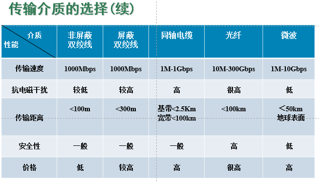

<!-- synced-from-vault: 02-计算机基础/计算机网络/计算机网络体系结构/物理层.md | updated: 2026-11-11 -->
# 物理层

> **摘要** · 章节定位
> 信号与编码、信道复用、基带/宽带、传输介质与连接方式
> 所属：[计算机网络体系结构](../计算机网络体系结构.md)


- 模拟信号：连续的，模拟信道---频带传输 ---调制解调
- 数字信号：离散的，数字信道---基带传输 ---数字编码

## 信道复用

- 码分复用CDM
- 频分复用FDM
- 波分复用WDM
- 时分复用TDM

## 通信方式

- 单工通信
- 半双工通信
- 双工通信
- 并行传输
- 串行传输

## 基带

基带信号就是消息源产生的原始电信号，比如计算机要发送的 0/1 数字脉冲。它的频谱通常从 0Hz 或很低频开始，没有搬到高频载波上。

基带传输就是直接把这串原始数字信号送到线路上，不经过载波调制。

**常见例子：**

- 以太网双绞线
- RS-232 串口
- 计算机主板上的数字信号
- 很多短距离有线数字通信

**特点：**

- 简单、成本低；
- 适合短距离、有线；
- 一根线通常传一路信号，多用时分复用；

长距离衰减大，不适合直接上无线。

## 宽带

在通信原理里，宽带通常指：把信号调制到不同的高频载波上，占用很宽的频带，可以同时传多路业务。它和“窄带”相对。

**比如 ADSL：**

- 0～4kHz 传电话；
- 高频段传上行/下行数据；

电话和上网互不干扰。

**常见例子：**

- ADSL、光纤宽带
- 有线电视同轴电缆上网
- Wi-Fi、4G、5G
- 电视、电话、数据同缆传输

**特点：**

- 需要调制解调；
- 适合长距离、无线、多业务；
- 可以用频分复用，把频带切成很多段；

日常“宽带”就是高速互联网接入，比如 100M、500M、千兆宽带。

## 数字通信系统

> 信源--信源编码--信道编码（差错检查）--调制器--信道--解调器--信道译码--信源译码--信宿

```text
                                            |
                                            |
                                           噪声
```

## 衡量标准

### 传输速率

- **码元传输速率**（波特率，常记 `RB` / `Rs`）：单位时间传输的码元数，单位 **Baud**
- **信息传输速率**（比特率，常记 `Rb`）：单位时间传输的信息量，单位 **bit/s**
- 关系：`Rb = RB × log₂M`，M 为码元进制数

> **提示** · 已修正（2026-11-06）
> 原笔记把码元速率记为 `Rb`，与信息速率符号混淆；「信息传输速率」一句未写完，此处补全。

### 频带利用率

在相同的时间系统的信息传输/信息所占的频带宽度

### 误码率和误信率

- **误码率**：出错码元数 / 传输总码元数
- **误信率**：出错信息比特数 / 传输总比特数
- 多进制调制下二者不相等，都是衡量信道可靠性的基本指标

## 基带传输

- 发送端：编码
- 接收端：解码
- 双极性的波形：冗余好
- 归零波形：同步信号
- 差分波形：电平是否跳变表示0，1，避免解码反了
- 频带宽，利用率低

## 编码（设备：编码器；调制/解调才用调制解调器 modem）

NRZ（Non-Return-to-Zero）：不归零编码

**Manchester：**

- 每位中间的跳变既表示数据，也提供自同步时钟（10Base-T 使用）
- 跳变方向表示码元

**差分Manchester：**

- 每位中间**始终**跳变，只用于提供时钟
- 位开始处**有无跳变**表示 0/1（具体约定以教材为准）
- 不依赖跳变方向，抗干扰强于绝对曼彻斯特编码

## 载波信号 → 数字信号

即**解调**：从已调载波中恢复基带数字信号，是调制的逆过程。本节原为课件截图，待补文字。

## 拓扑

- 将网络中的设备抽象成点，连接抽象成线
- 总线型（Bus）
- 星型
- 树型（拓展星型）
- 环形
- 网状型

### FSK 调频（抗干扰强）

- 频率表示二进制
- 一个载波发生器开关产生

### ASK 调幅（抗干扰弱）

- 振幅变化表示二进制
- 通过两个载波发生器选择开关产生不同频率的波形

### PSK 调相（抗干扰强，编码效率强）

- 通过绝对调相和相对调相
- 多相调制提供高效率

## 信道复用

> 复用器  ----------------------------   分用器

### FDM 频分复用（频带）

- 信道宽，信号带宽小
- 相同时间，在一个信道上，在频率范围上划分

### TDM 时分复用

- 将工作时间分成若干等长的时隙，多路信号采用轮换的方式使用信道
- 在一个TDM帧内不同信路，分别使用信道

#### ATDM 异步时分复用

时隙不固定分配，而是按需动态分配。

#### 数字复接

多路低速数字流合成一路高速数字流的时分复用技术。

##### 按位复接

##### 按帧复接


### WDM 波分复用

对于光来说

### CDM 码分复用

- 每一个用户，可在同样的一个时间使用相同频率进行通信
- 每个用户使用挑选的不同码形（每个码形不会干扰）

## 信号衰减

- 信号能量在传输过程中越来越小，传输距离受限
- 解决思路：信号放大器（有源设备） 整形电路

### 设备

- Hub：集线器
- 中继器

## 信号干扰

### 噪声

- 在原始信号之上加上不期望的信号，会产生失真
- 信噪比影响信号传输
- 如何减少：提高信噪比（信号的能量大）
- 减少或远离噪声源
- 好的介质
- 使用抵消或者屏蔽技术

## 介质



## 连接方式

- DTE（终端设备）
- DCE（数据链路端接设备）
- 何为相同类型（在体系结构中最高层相同）

### 直通线（不同类型设备）

- 线序：两端完全一样，两端都是T568A，或两端都是T568B
- 用途：不同类设备的以太网口相连
- PC ↔ 交换机/Hub；路由器 ↔ 交换机；Hub ↔ PC

### 交叉线（相同类型设备）

- 线序：一端T568A，一端T568B；只互换1↔3、2↔6脚
- 用途：同类设备以太网口相连
- PC↔PC；路由↔路由；SW↔SW；SW↔Hub；Hub↔Hub

### 控制线（反接线）

线序：8根线整体完全颠倒：一端1→8，另一端8→1（全部反过来）

用途：PC串口 ↔ 路由器/交换机 Console控制台口，用来登录配置设备


## 相关笔记

- [↑ 返回总览：计算机网络体系结构](../计算机网络体系结构.md)
- [下一章：数据链路层 →](数据链路层.md)
- 计算机网络知识地图
- 总知识地图

<!-- vault-sync: 由 D:/library/nico 自动同步，请勿在博客侧手工编辑 -->
