<!-- synced-from-vault: 03-编程与开发/微信小程序开发.md | updated: 2026-11-06 -->
# 微信小程序开发笔记

<!-- guide-start -->
> **本篇定位**：小程序开发入门记录：JavaScript 语法、UI、输入、页面跳转与数据库。
>
> **学习重点**：按「变量 → 比较 → 对象/数组 → UI → 页面 → 数据库」顺序看，代码块建议照着敲一遍。
>
## 本篇导航

- UI
- 输入
- 增加页面
- 10.30
- 数据库

> **自测**：① === 与 == 的区别？② splice 与 concat 分别对原数组做了什么？

---

<!-- guide-end -->

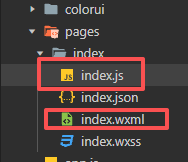

应用程序开发是基于事件的

## JavaScript 基础

### 语法

#### 变量

定义变量

```javascript
var a = 10
let b = 20
//输出a和b
console.log(a, b)
let c = 'a'
console.log(c)
let d = "woshidasabi"
let e = [1, 2, 3, 4, 5]
let f = ["a", "b", "c"]
//console是控制台 .log是日志
```

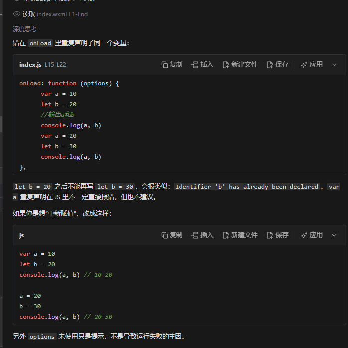

```javascript
let name ="zhangsan"
let age = 18
console.log(name, "is" , age)
let arr =[1 , 2 , 3 , 4 , 5]
console.log(arr)
//arr.length   arr的长度
```

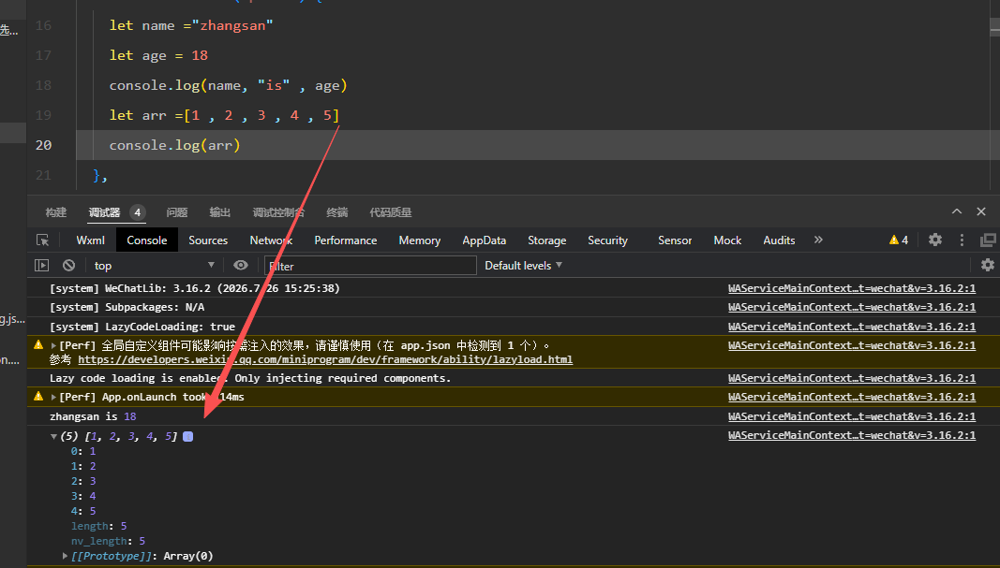

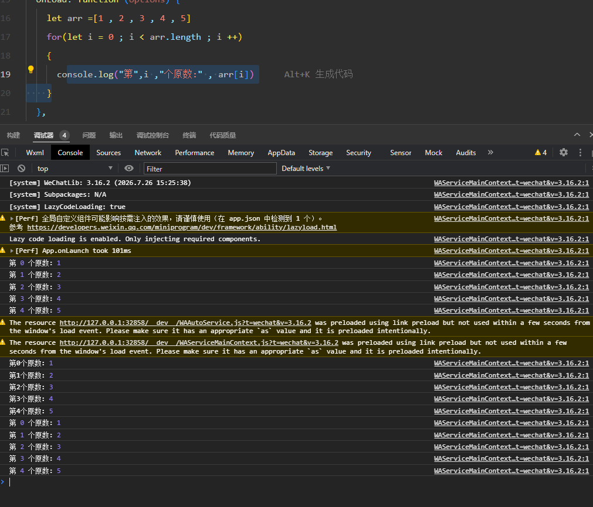

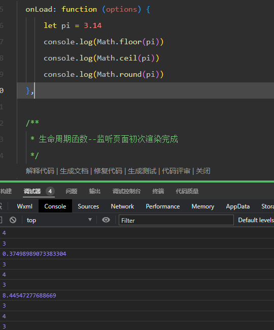

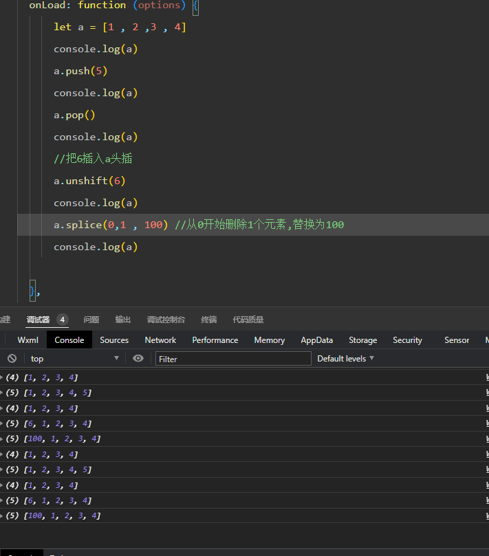

#### 比较

- `===` **严格相等**：类型与值都相同才为 true，不做隐式转换
- `==` **宽松相等**：类型不同时先做隐式类型转换再比较，规则较复杂；建议一律用 `===`

#### 对象

```javascript
let person ={"name" :"sb" ,
"age" : "11",
"sex" : "nan"
}
console.log(person.age)
console.log(person["name"])
```

#### 数组

```javascript
let arr = [10,20,30]
arr[arr.length] = 40
arr.push(50)
console.log(arr)
arr.splice(1,1)
console.log(arr)
delete arr[2];  /* 只把该位置变成空位(empty)，数组长度不变；删除元素请用 splice */
console.log(arr)
let arr2 = [100 ,1000, 100000]
let me = arr.concat(arr2)
console.log(me)
//let arr2 = [100 ,1000, 100000]
//arr.push(...arr2)
//console.log(arr)
//let arr2 = [100 ,1000, 100000]
//let me = [...arr , ...arr2] //推荐
//console.log(me)
/* 示意：index / howmany 需替换为实际值；splice 会修改原数组，并返回被删元素组成的新数组 */
let newarr = arr2.splice(index, howmany);
```

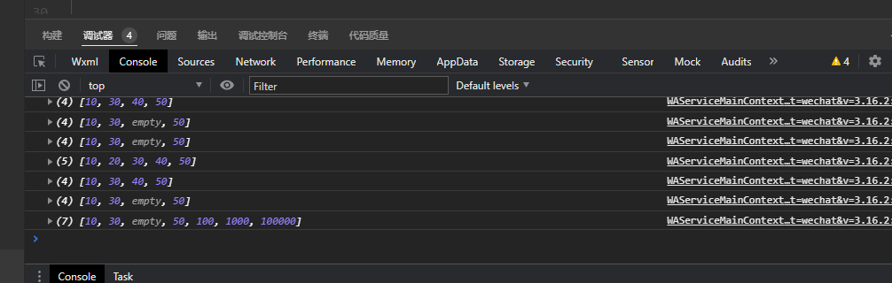

查找

```javascript
let arr = ["sb" , "sb1","sb2"]
let indx = arr.indexOf("sb")
console.log(indx)
```

## UI

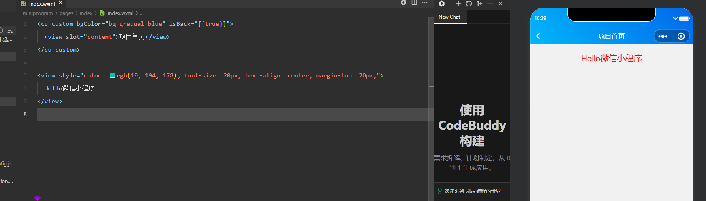

color设置颜色，font设置字体

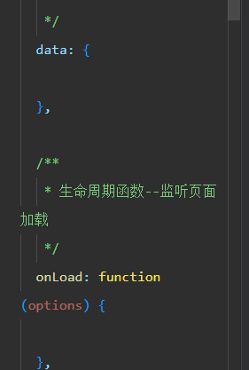

- data里面的数据js和wxml都可以读取，不用加类型名
- 在onloadfunction里面或者其他模块使用并且更改不会应用
- 可以使用this.setData({data里的数据:"更改后的值"})
- 在wxml两个花括号表示变量{{}}
- 输出数组

```wxml
<!-- wx:for 遍历 Page.data 中的 arr；wx:if 做条件渲染 -->
<view wx:for="{{arr}}" wx:key="*this">
  第 {{index + 1}} 个是 {{item}}
</view>

<view wx:if="{{a > 10}}">
  a > 10
</view>
```

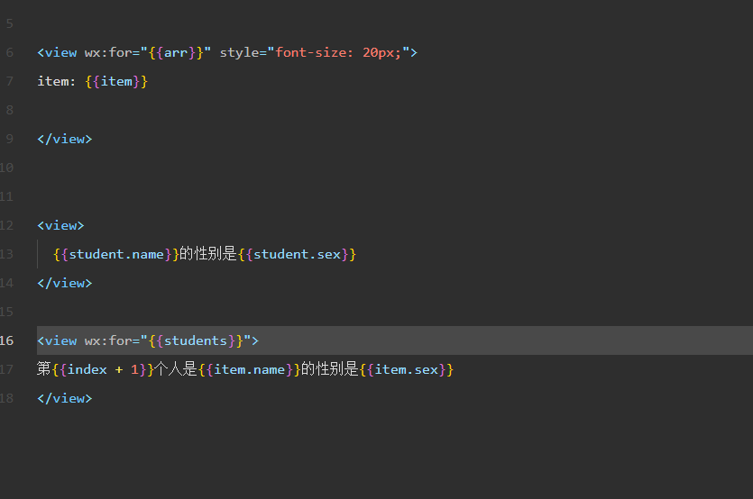

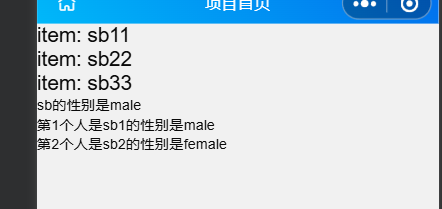

## 输入

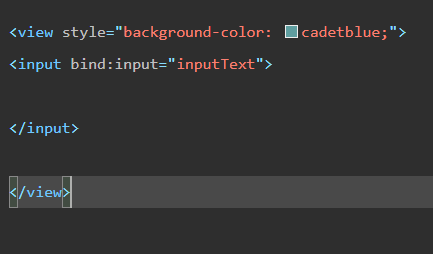

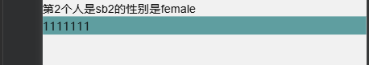

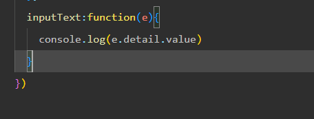

内容写在形参的detail的value中

## 增加页面

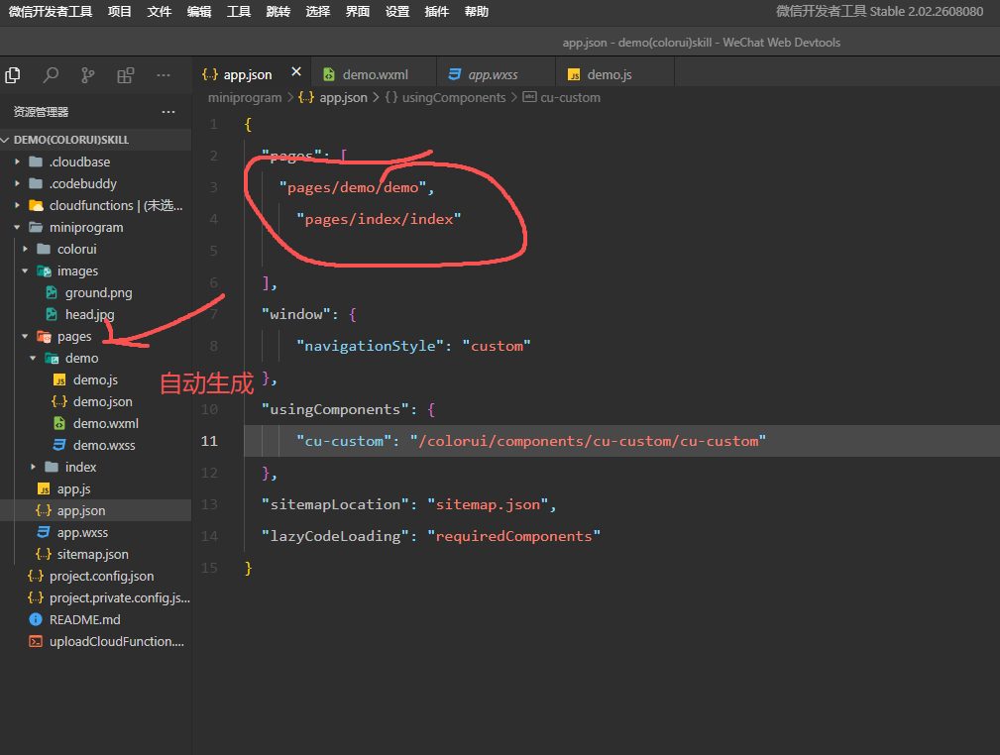

## 云开发（10.30 课堂记录）

云开发

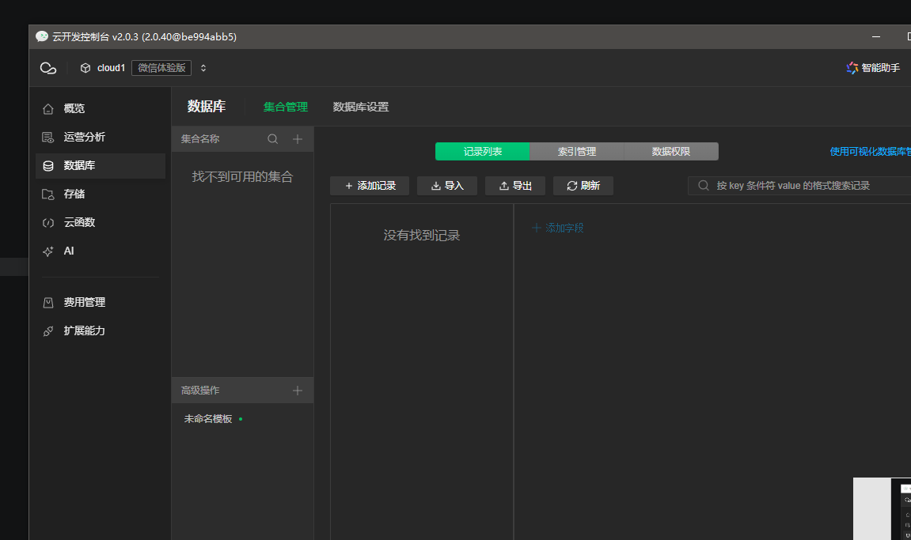

## 数据库

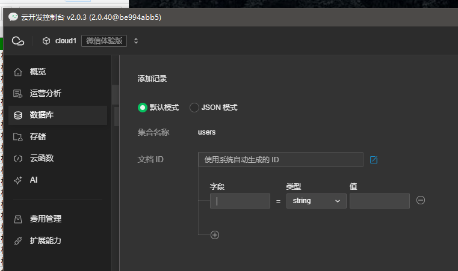

ID要保持唯一
# 11.6微信


## 相关笔记

- 编程开发知识地图
- 项目实践知识地图
- 总知识地图

<!-- vault-sync: 由 D:/library/nico 自动同步，请勿在博客侧手工编辑 -->
