# CTF 入门与题型总览

<!-- guide-start -->
> **本篇定位**：CTF 入门总览：赛制与题型、常用工具、编码与隐写、Misc 解题思路和真题演练。
>
> **学习重点**：先记工具与特征（Base64/Base32、文件头、PNG IHDR），再跟着 Misc 真题走一遍完整流程。
>
## 本篇导航

- 软件
- misc思路
- 杂项的解题思路
- MISC真题演练

> **自测**：① Base64 与 Base32 的字符集特征？② 修改 PNG 宽高为什么要重算 CRC？③ 文件分离常用哪几个工具？

---

<!-- guide-end -->

网页导航

[navisec](https://navisec.io/)

[渗透师](https://www.shentoushi.top/)

https://tools.qsnctf.com/#//home

### 工具

- binwalk
- file
- zsteg
- 010editor
- zbarimg xxx.png //扫码工具

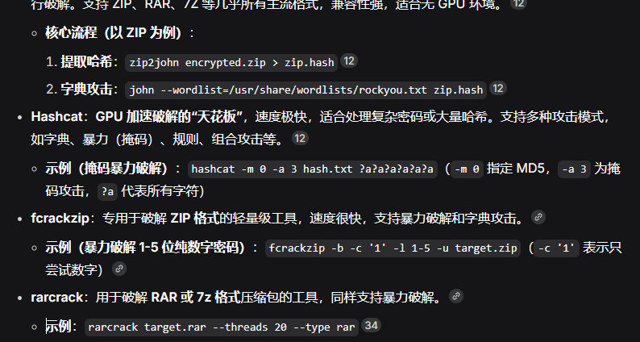

Base64 特征：字符集 A-Z a-z 0-9 + /，末尾常有 = 填充。
Base32 特征：字符集 A-Z 2-7，通常全大写，长度是 8 的倍数，末尾常有 =。
URL Safe Base64：把 + / 换成 - _，解码前先替换：
```bash
echo "你的字符串" | tr '_-' '/+' | base64 -d
```

在线网址：http://www.hiencode.com/base64.html

循环反复尝试 base64 / base32。

在线hex转文件的网址  https://gchq.github.io/CyberChef/

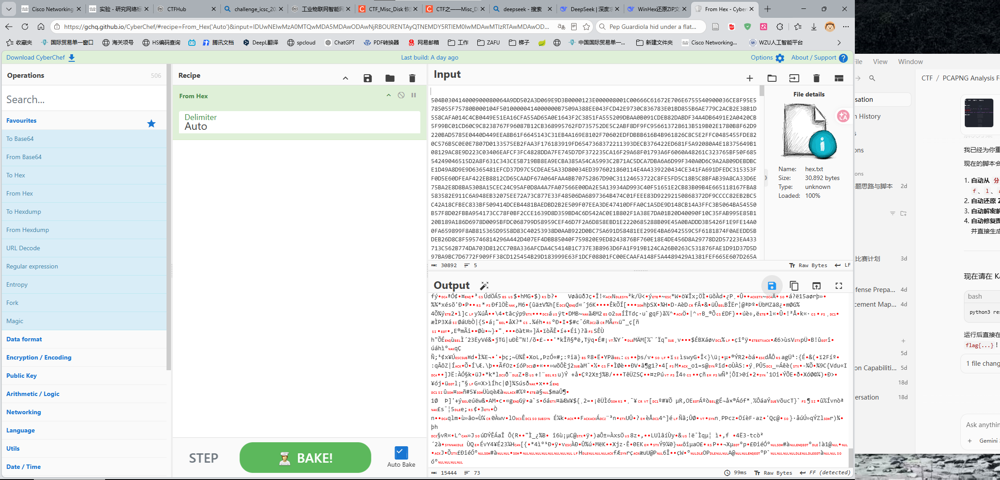

- 将文件拖入input，左侧选择for hex
- output选择save

### 基本赛制与题型

- 题目 ---》 flag ---> 分数 ---》名次
- i春秋，e春秋

### 目标

获取flag


### 比赛形式

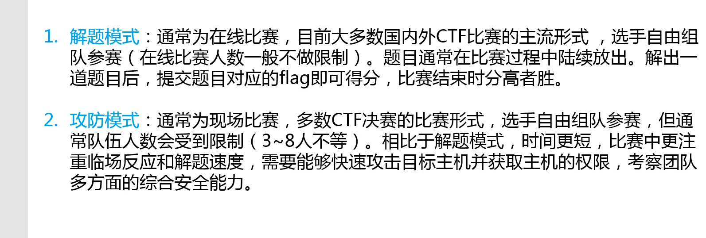

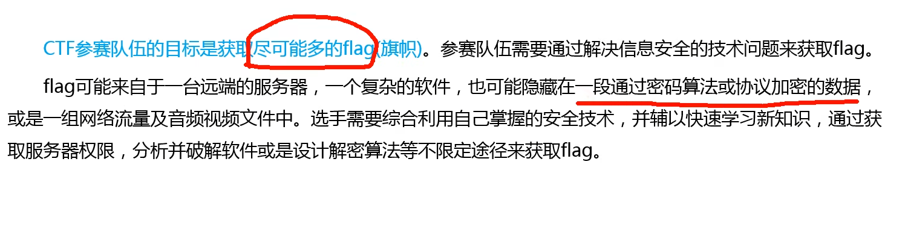

### 题目类型

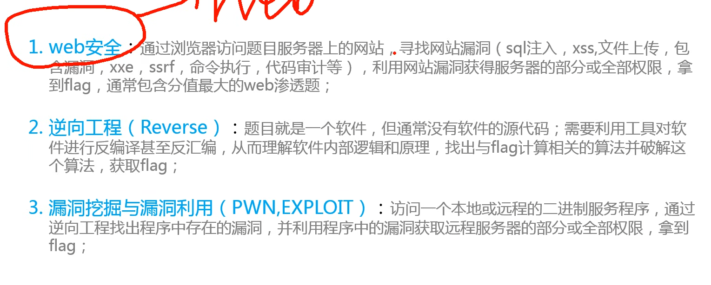

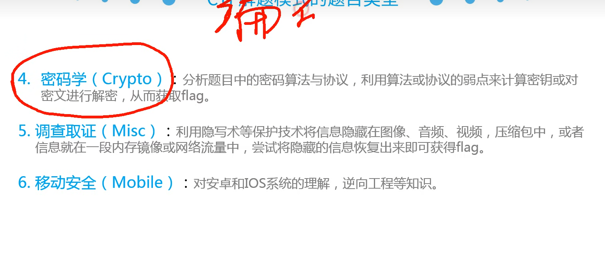

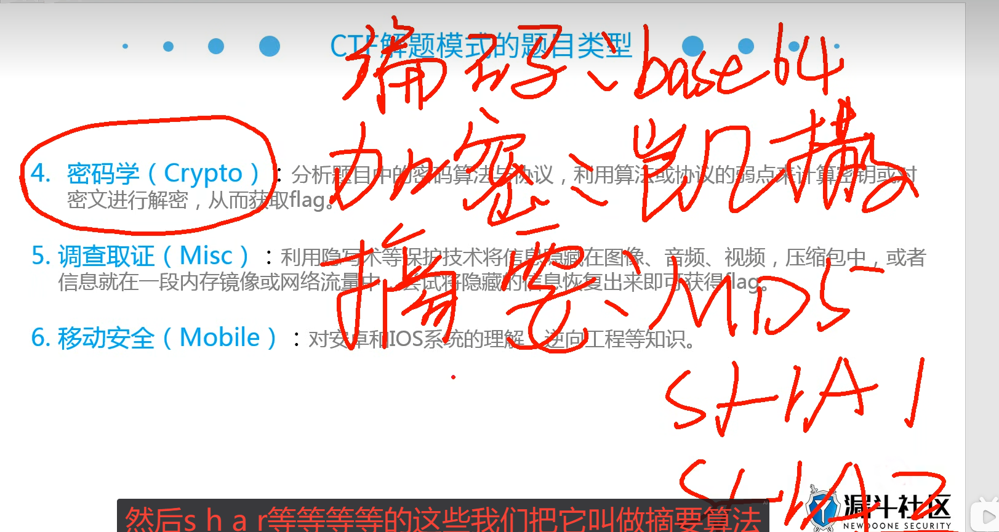

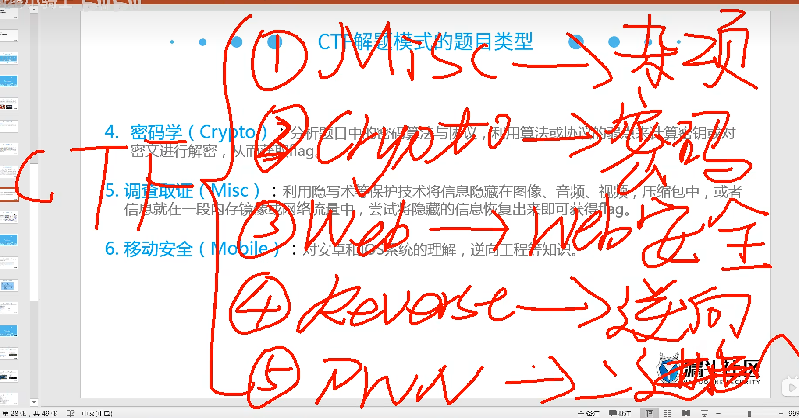

### 学习攻略

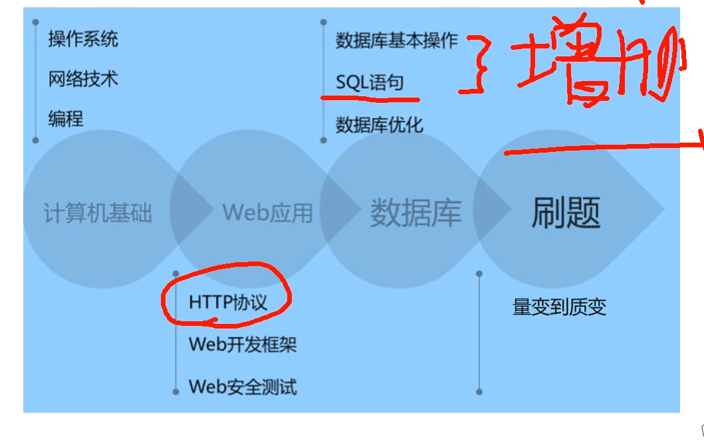

*  网络技术
*  http协议
*  数据库的基本操作，Sql语句（增删查改，ADFC），数据库优化

### 在线演练

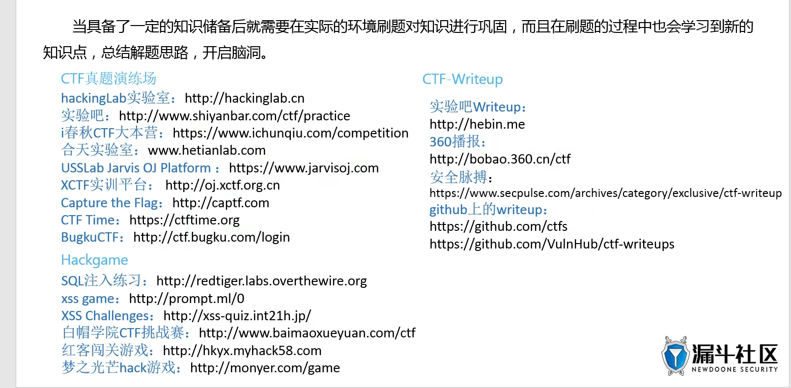

实验吧：http://shiyanbar.com/ctf/practice

BugkuCTF: http://ctf.bugku.com/login

## 软件

- vm，bp
- kalilinux:已经安装了很多的软件和工具

```bash
firefox-esr //狐火
```

## misc思路

- 1，先查看文件类型
- {
- 有些时候是假的文件头，就要进行替换
- 可以先直接进行vim或者010查看并搜索flag字样
- }
- 根据类型进行下一步
- 2，如果是图片先看看exif(查看图片信息)
- {
- 若png有问题在在线工具中进行修复尺寸
- png还会有LSB隐写{
- 使用zsteg
- }
- }
- 3，查看隐藏文件是否有
- {
- 有的话就分离
- foremost
- binwalk
- dd
- 根据分离的文件类型可能是zip，rar的压缩类型
- {
- zip如果是加密的话可以先看看是不是伪加密的

用16进制编辑器进入后，搜索504B0102，后的第5，6个字符，改成0000

- rar的话是第24位的尾数改为0，4是加密
- {
- 如果是真加密
- }
- }
- 非压缩类型再次vim或010查找flag
- {
- 有二维码可以通过QRsearch
- 或者zbarimg xxx.png
- }

}

## 杂项的解题思路

### 文件类型的识别

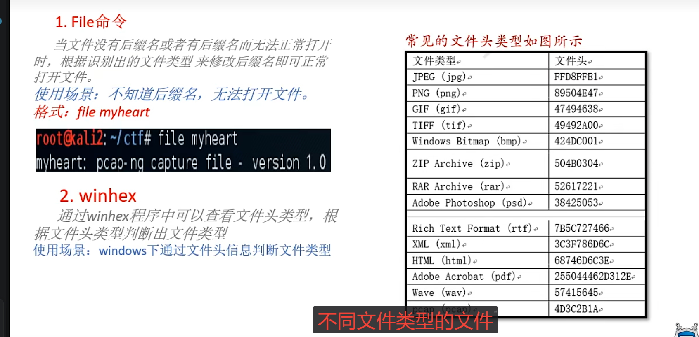

```bash
file xxxx
```

更改后缀名，可以将文件的原貌得出

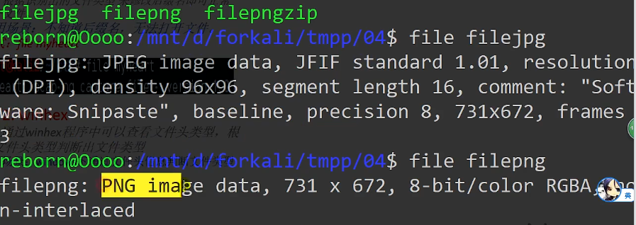

```bash
winhex //通过识别文件头，用于windows下的情况
```

```bash
010editor filename
```

通过010编辑器打开文件，通过查看头文件的第一位16位数值来判断是什么文件

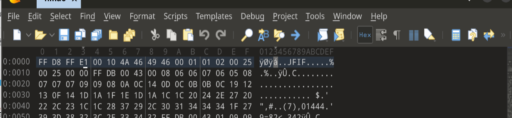

### 文件分离

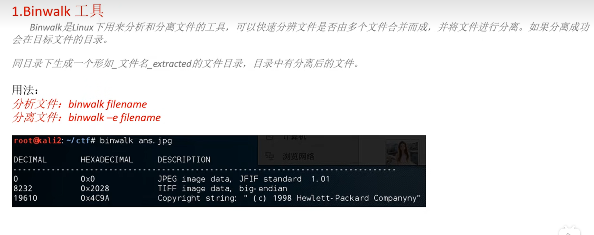

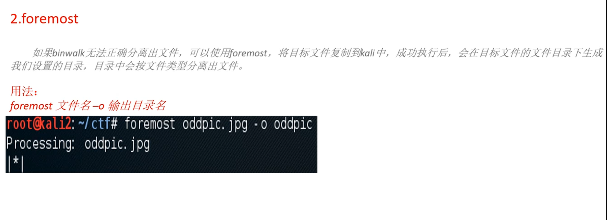

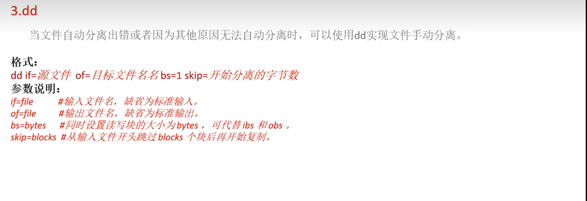

- EX1
- 1.txt:1234567890abcdefghjk
- dd if=1.txt of=2.txt bs=5 count=1
- 2.txt:12345
- dd if=1.txt of=3.txt bs=5 count=2
- 3.txt:1234567890

dd if=1.txt of=4.txt bs=5 count=1 skip=1

4.txt:67890

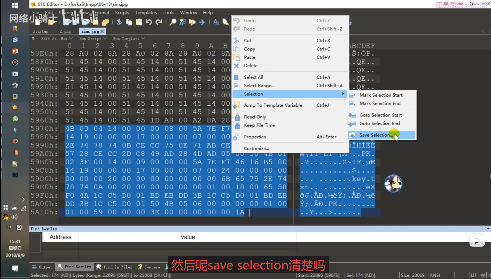

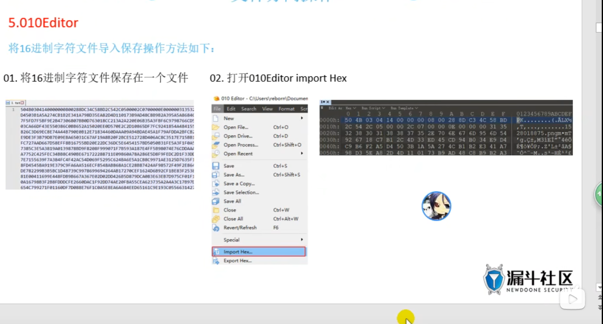

### 文件合并

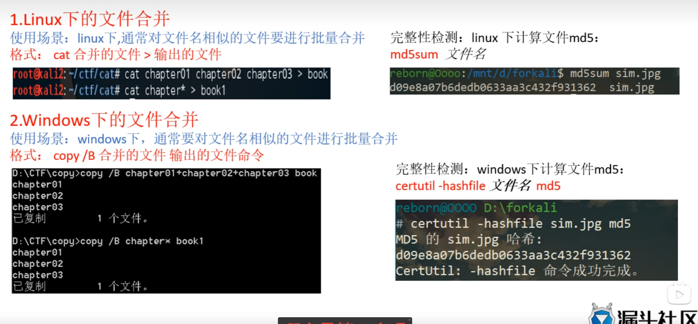

合并后还要根据md5来判断是否合并成功

### 图片隐写

#### 细微的颜色差异

#### GIF多帧隐藏

- 颜色通道隐藏
- 不同帧图信息隐藏
- 不同帧对比隐写

#### Exif信息隐藏

```bash
exiftool filename
```

#### Steglove

! [alt text](image-18.png)
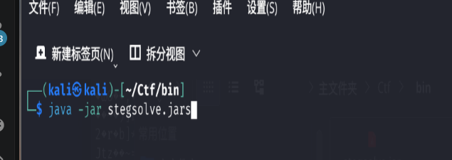

#### 图片修复

- 图片头修复
- 尾修复
- crc循环效验修复
- 长宽高修复
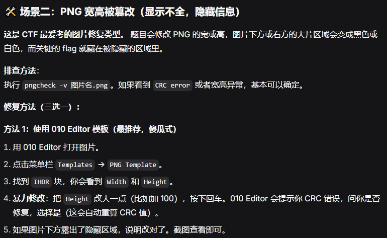

```python
import zlib
import struct

filename = "图片名.png"
# 读取文件数据
with open(filename, 'rb') as f:
    data = bytearray(f.read())

# PNG 的 IHDR 块从第 16 字节开始，宽 4 字节，高 4 字节
# 利用已知 CRC 来爆破高度（因为修改宽高会导致 CRC 校验失败，我们反过来利用 CRC 去猜高度）
crc32_expected = struct.unpack(">I", data[29:33])[0] # 原始 CRC

for h in range(1, 2000): # 假设高度在 2000 以内
    # 修改高度字段
    data[20:24] = struct.pack(">I", h)
    # 计算新的 CRC (PNG 的 CRC 是根据 "IHDR" + 宽 + 高 + 位深 + 颜色类型 + 压缩 + 过滤 + 隔行扫描 计算的)
    crc32_calc = zlib.crc32(data[12:29]) & 0xffffffff
    if crc32_calc == crc32_expected:
        print(f"找到正确高度: {h}")
        with open("fixed.png", "wb") as f:
            f.write(data)
        break
```

#### 最低位有效位LSB隐写

- Stegslove可以用来处理LSB隐写，在DATA EXact中
- 对于图像的RGB有8位，把信息隐藏在最后一位

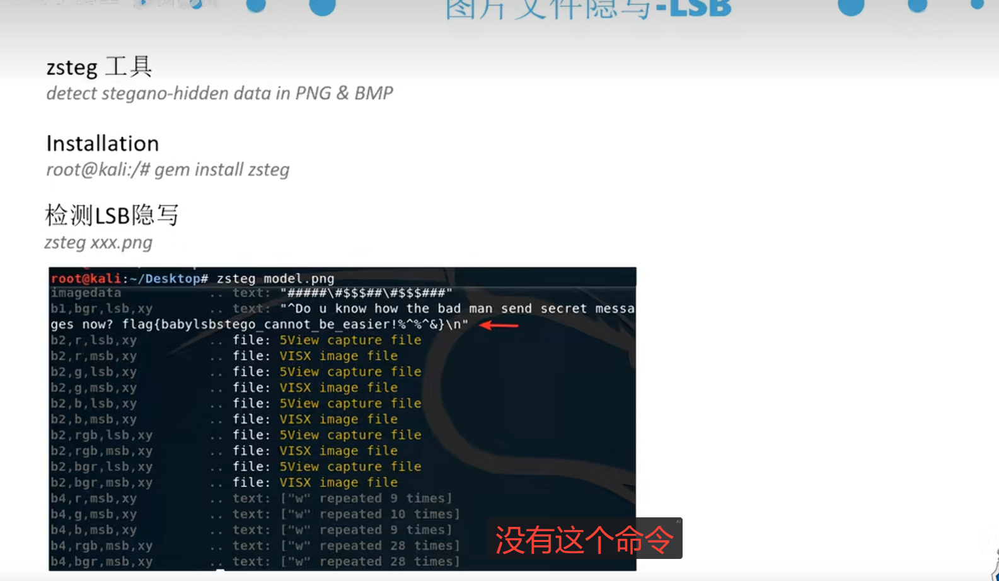

对于pdf，bmp的

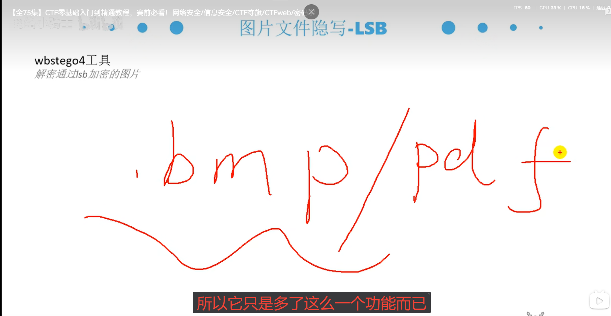

图片残缺修复

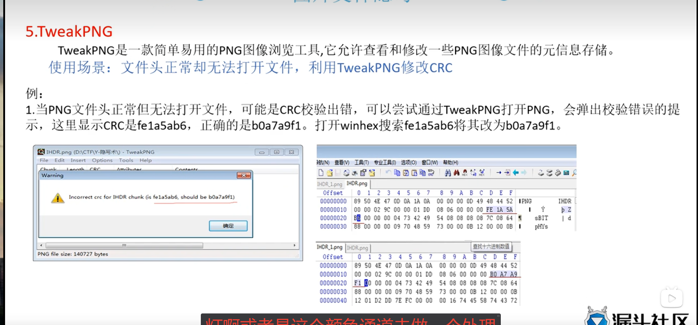


##### PNG图像源文件含义

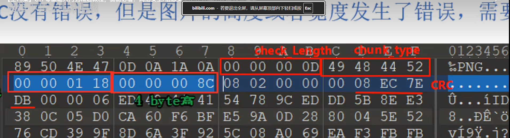

#### 图片加密

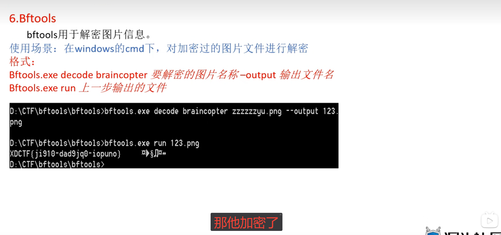

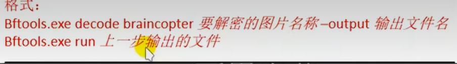

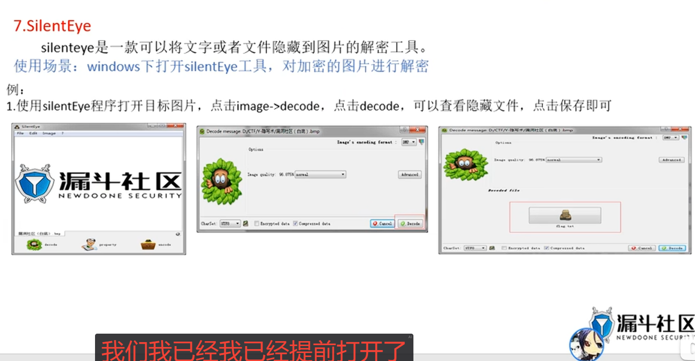

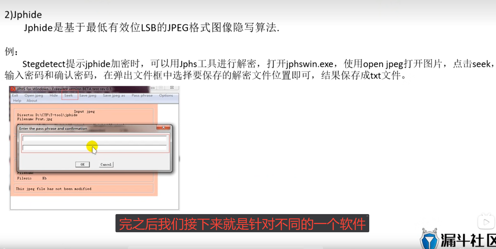

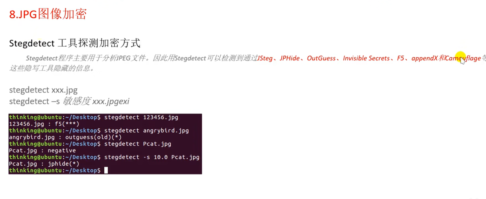

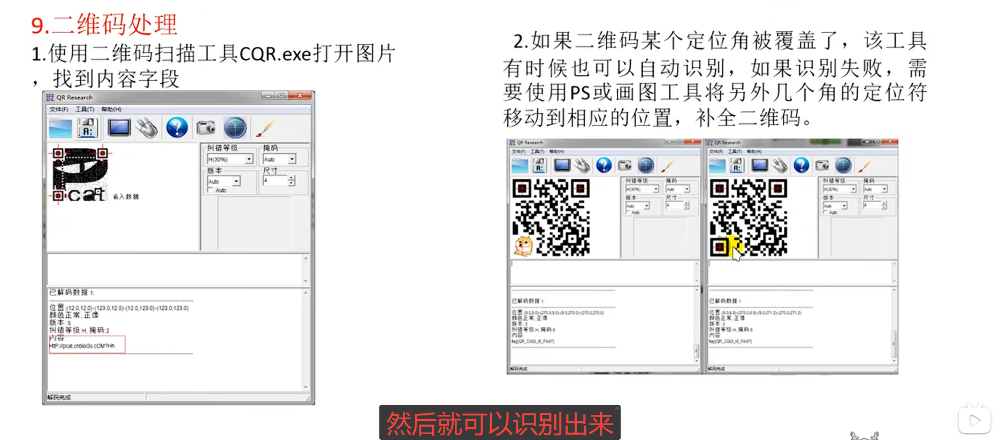

- Stegdetect
- outguess
- Jphide
- F5
#### 遇到打开是乱码的用16进制查看器

#### 总结

🧭 第一步：通用排查（适用于所有图片）
不管拿到什么图片，先用这几招过一遍，能筛掉一半的题：

看真实类型：file 文件名。如果提示是 PNG 但后缀是 JPG，或者提示是 ZIP、RAR，直接改后缀或按相应格式处理（常有“图种”或修改文件头）.

搜关键字：strings 文件名 | grep -i 'flag\|ctf\|key'。很多简单题直接把 flag 写在二进制数据里。

看元数据（EXIF）：exiftool 文件名 或 exiv2 文件名。常有 Comment 字段、拍摄地点、相机型号里藏 flag。

分离附加文件：binwalk -e 文件名 或 foremost 文件名。看看图片尾部是不是拼接了 ZIP、PNG，提取出来。

十六进制查看：xxd 文件名 | head 或 xxd 文件名 | tail。看头部是否被修改（比如 PNG 头被改了），或者尾部是否有追加数据。

🖼️ 第二步：按后缀精准打击
1. JPG / JPEG 后缀
JPG 是有损压缩，不适合做 LSB 隐写，所以常见的套路是“加密隐写”。

主力工具：steghide / stegseek

解题步骤：

尝试无密码提取：steghide extract -sf 文件.jpg

如果提示需要密码，直接用 stegseek 爆破解密：
stegseek --crack -sf 文件.jpg -wl /usr/share/wordlists/rockyou.txt

如果 stegseek 没结果，尝试 stegseek --seed 文件.jpg 检测是否根本不是 steghide。

其他怪招：outguess、jphide、F5 隐写（需要专门的检测工具，如之前提过的 stegdetect，但成功率低，建议先用 stegseek）。

2. PNG 后缀
PNG 无损压缩，是 LSB（最低有效位）隐写的重灾区，也是 CTF 最爱考的格式。

主力工具：zsteg、Stegsolve、pngcheck

解题步骤：

LSB 扫描：zsteg -a 文件.png。它会列出所有可疑通道，如果看到字符串或 PK 头（ZIP文件头），用 zsteg -E "通道名" 文件.png > output 提取。

图形化分析：运行 java -jar stegsolve.jar，使用 Analyse -> Data Extract 勾选 Red/Green/Blue 的 0 位，看能不能看到清晰的二维码或字符串；或者用 Frame Browser 查看帧（动图）。

结构检查：pngcheck -v 文件.png。如果提示 CRC error（CRC 校验错误），说明宽高被修改过，或者 IDAT 数据块被篡改。

宽高修改（高频考点）：如果图片显示不全，用 Python 脚本爆破/修改 IHDR 块里的宽和高，并修复 CRC 值。

双图对比：两张图片长得很像，大概率是“盲水印”。需要用到 blind-watermark 等脚本或者在线工具。

3. BMP 后缀
BMP 是未压缩格式，体积大，也常用来做 LSB 隐写。

主力工具：zsteg、Stegsolve、wbStego
解题步骤：
直接上 zsteg -a 文件.bmp，经常能扫出 LSB 数据。
如果是调色板隐写（Palette-based），需要写 Python 脚本（用 PIL 库）读取调色板顺序，或者用 Stegsolve 的 Colour Palette 功能查看。

有时候是 wbStego 加密，如果 zsteg 没结果，可以尝试用 stegseek（它也支持 BMP）。

4. GIF 后缀
GIF 是动图，核心考点在多帧和调色板。
主力工具：Stegsolve、ffmpeg、identify
解题步骤：

分帧：用 ffmpeg -i 文件.gif frame_%d.png 或 convert 文件.gif frame_%d.png 把每一帧切出来，逐一查看是否有隐藏文字或残缺二维码。

帧时间隐写：有些题目把 flag 的二进制写在了每一帧的延时时间（帧间隔）里。需要用 identify -format "%T\n" 文件.gif 获取每帧延时，然后把 10ms/20ms 转换成 0/1 再转 ASCII。

调色板隐写：同 BMP。

Stegsolve 帧浏览：在 Stegsolve 里用 Frame Browser 可以逐帧查看，非常方便。

### 压缩文件分析

#### 伪加密

如果压缩文件是加密的，或文件头正常但是解压失败，首先尝试文件是否位伪加密

zip文件是否加密由标识符显示，再每个文件的目录有一位专门来表示是否加密，将其设置为00表示未加密

如果这时候解压成功了，说明是伪加密，否正出错为真加密

用16进制编辑器进入后，搜索504B0102，后的第5，6个字符，改成0000

rar的话是第24位的尾数改为0，4是加密

#### 暴力破解

- 利用ARCHPR工具（F:/CTFtools/Arc）
- 已知前几位

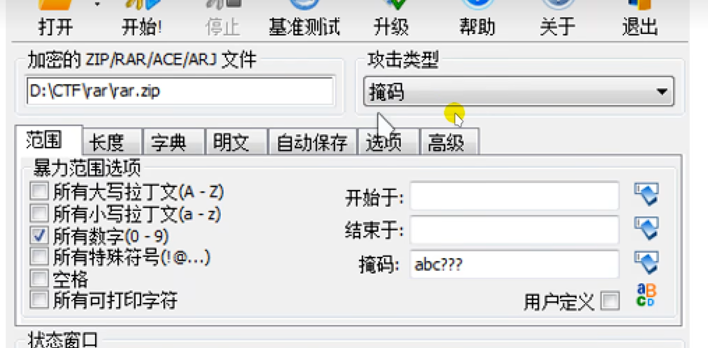

#### 哈希对比

工具zip2John

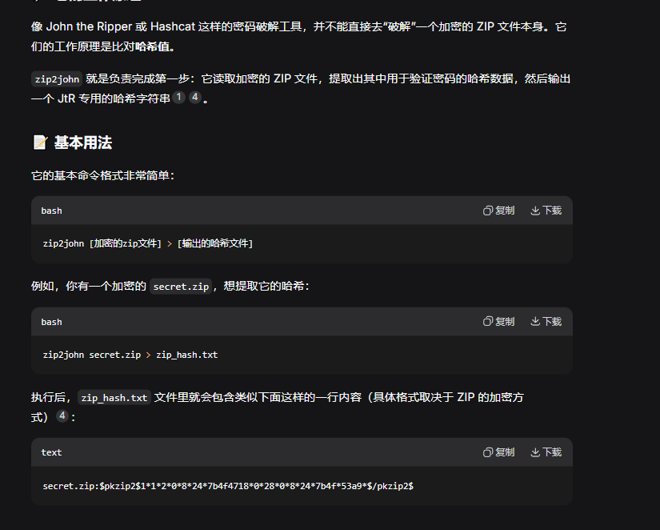

#### 明文攻击

- 知道加密的zip中的部分明文内容，利用这些内容推测出密钥并解密zip
- 相比于暴力，这种在破解比较复杂的压缩包时效率更高

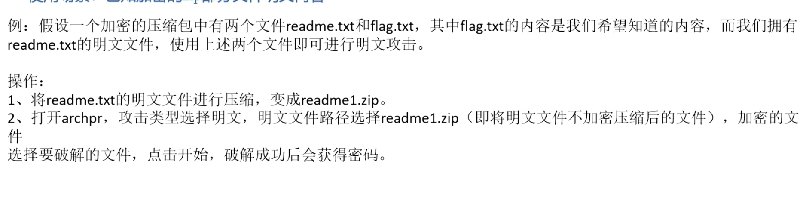

tips：明文压缩的算法和加密的压缩算法一样

### 流量取证

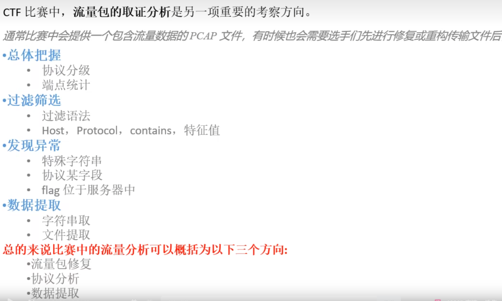

#### wireshark

##### 过滤指令

源ip或者目的ip

```wireshark
ip.src eq x.x.x.x or ip.dst eq x.x.x.x  
ip.addr eq x.x.x.x
```

过滤http

```wireshark
tcp.port eq 80 or udp.port eq 80   
tcp.dstport == 80 //tcp目的端口为80
tcp.srcport == 80 //tcp源端口为80
tcp.port >= 1 and tcp.port <= 80
```

- 过滤协议tcp/udp/arp/icmp
- 过滤MAC

```wireshark
eth.dst == xx:xx:xx:xx:xx:xx 过滤目标
```

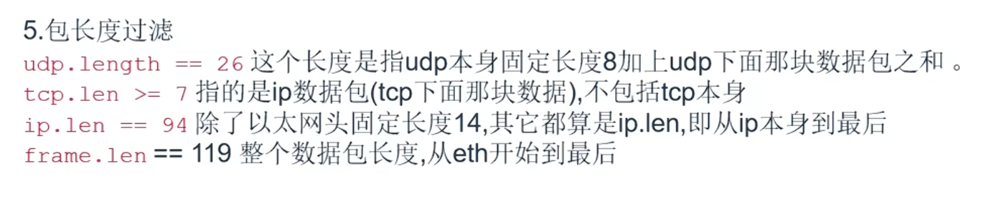

http模式过滤

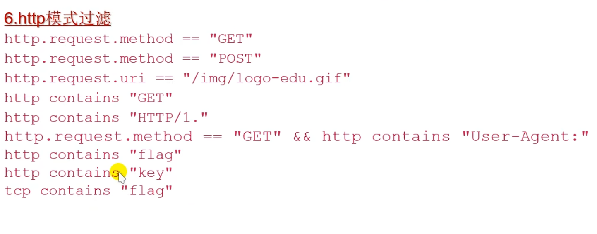

```wireshark
http.request.method == "GET"
http.request.method == "POST"
http.request.uri ==" "
http contains "GET"
http contains "HTTP/1."
http.request.method == "GET" && http contains "User-Agent:"
http contains "flag"
http contains "key"
tcp contains 'flag'
```

##### 解题过程

- 拿到pcap后先用wireshark分析数据报的组成部分
- 主要是IPV4的

如果是http的部分，文件是分块传输的，要把他们合并起来

根据数据包的特征筛选

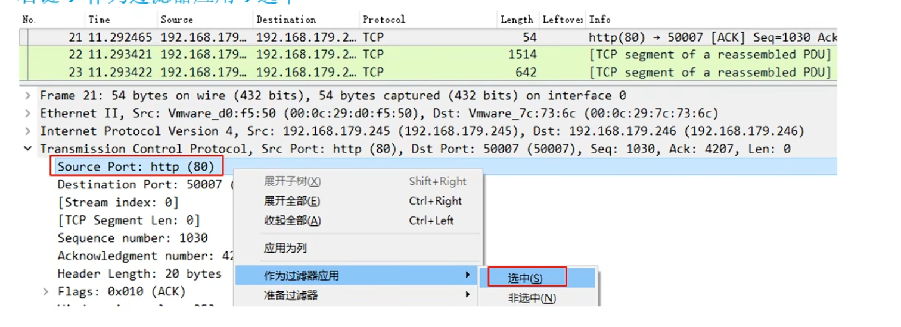

流汇聚

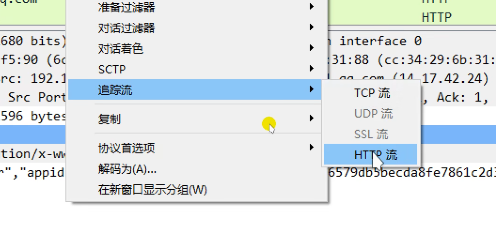

在关注的数据报中进行流汇聚可以还原成数据

**http流中包含重要内容：**

- 1，html中直接包含重要信息
- 2，上传或下载文件中包含文件名和hash，常用post请求上传
- 3，一句话木马，post请求，内容包含eval，用base64加密

wireshark里面可以进行数据提取自动提取http传输的文件内容

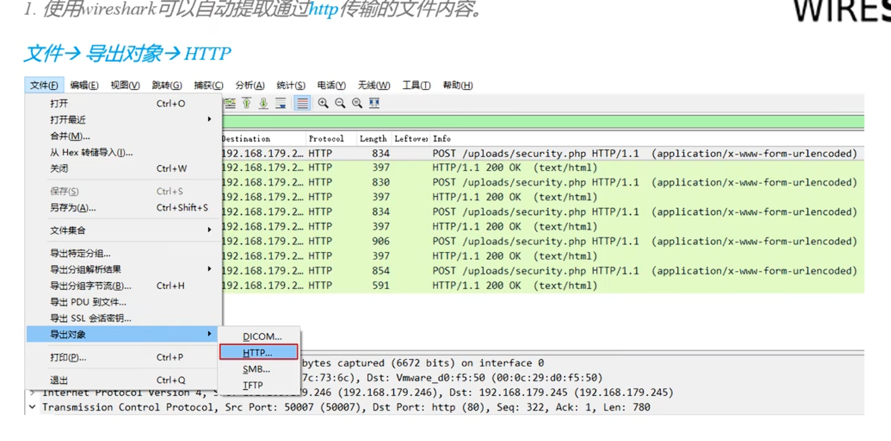

导出单个分组的字节流

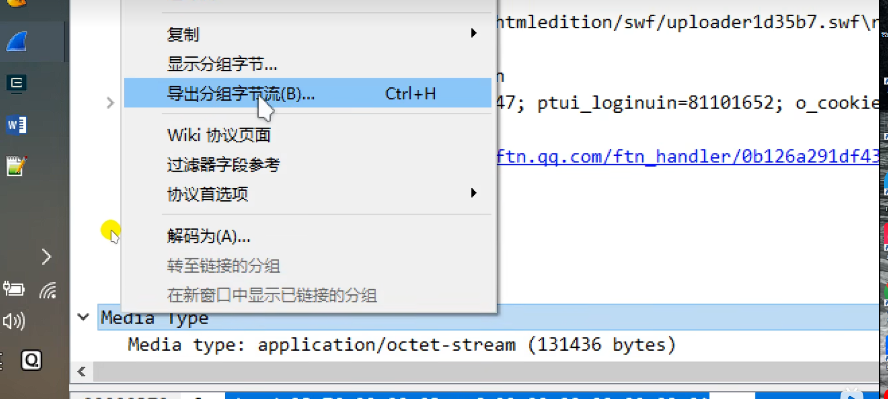

##### WIFI流量的分析

- kali中利用aircrack-ng xxx.cap进行无线密码破解
- wifi加密WPA， WEQ ， WPA2
- aircrack-ng xxx.cap -w pass.txt

##### USB流量分析

在线网址 tools.qsnctf.com/misc/usb_flow_analyze

USB协议数据部分在Leftover Capture Data中

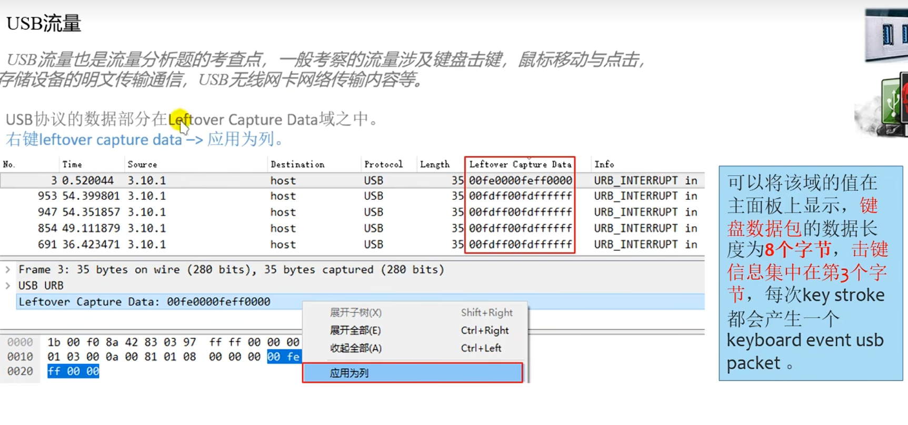

键盘数据包的长度为8个字节，击键星系在第三个字节，而每次key stroke都会产生一个keyboard event usb packet

- 提取data方法
- 1，导出为CSV（不好用）

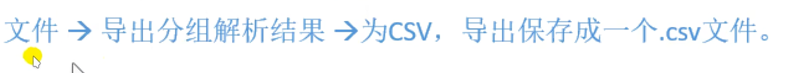

2，tshark，将lcd的数据单独复制出来

```bash
tshark -r usb1.pcap$目的文件$ -T fields -e usb,capdata > usbdata.txt$写出文件$
```

##### COTP协议

- COTP
- 可以理解为基于TCP的工控TCP，主要有五种类 型：
- CR Connect Request (0x0e)——握手，发送方发送
- CC Connect Confirm (0x0d)——握手，接收方发送
- DT Data (0x0f)——传正常数据
- UD User Data (0x04)——少见，传自定义数据
- ED Expedited Data (0x01)——少见，传紧急数据

CR和CC只在建立连接时由双方发送，发起方发送CR，被动方发送CC，后续数据主要走DT。因为协议类似于TCP，较为底层，所以没有其他比较有用的协议字段可供解题；同样因为COTP较为底层，用来出题的概率较小，就像用纯TCP出题的概率一样

默认端口是102

http://www.efittech.com/hxdec.aspx

汉信码

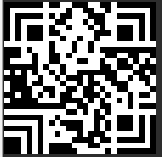

- 密文有斜杠可能是rabbit加密
- 解密网址
- www.sojson.com/encrypt_rabbit.html

PNG头文件base64加密后

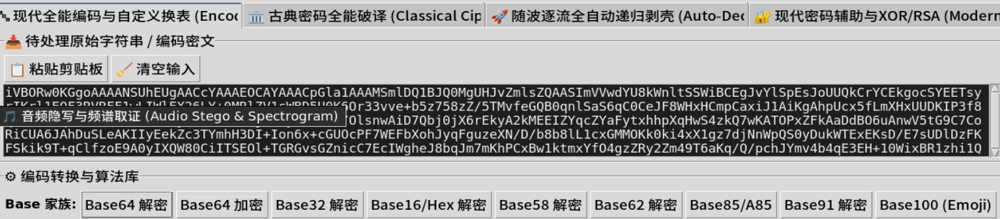

## MISC真题演练

### bugku

#### 这是一张单纯的图片

#&的大概率时html编码

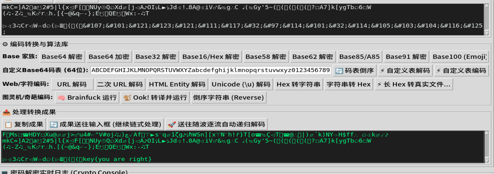

#### linux

直接拖入工具台

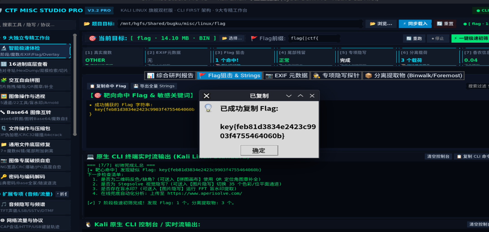

#### 隐写

png高度被修改

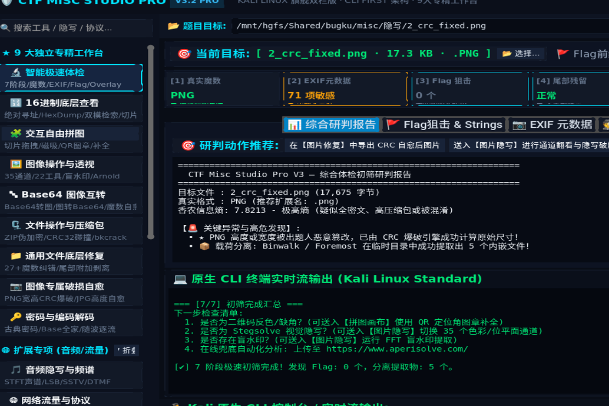

#### talent

在工具台中过滤flag

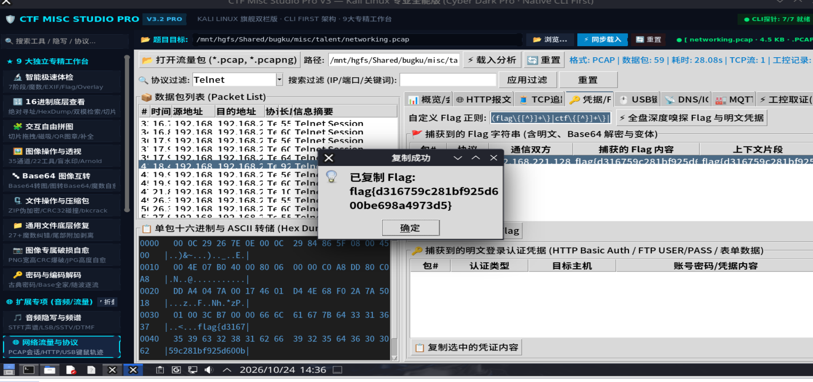

#### 眼见非实

- 发现是zip，改一下啊后缀
- 解压，一个文件一个文件找

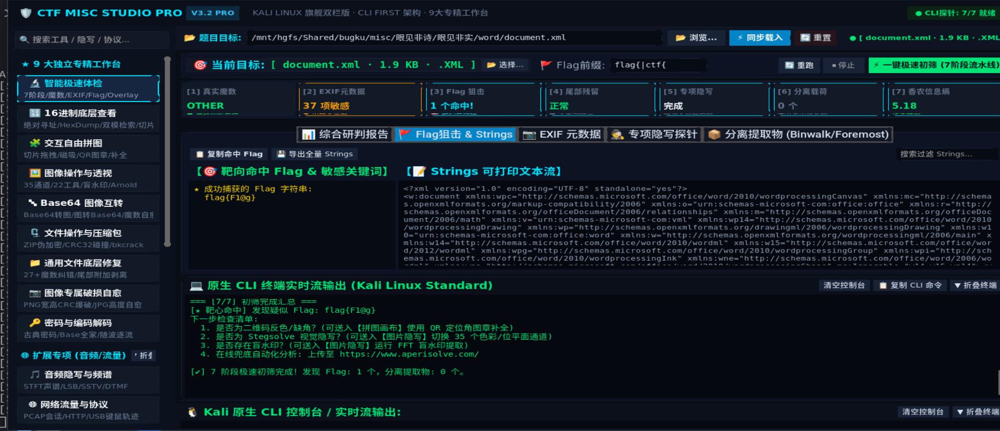

#### 多种发发解决

工作台中发现是base64编码的，转一下图片


转出来是二维码，扫一下


#### linux2

导入工作台，直接得出


#### 又一个单纯图片

放入工具台发现又隐含文件


#### 闪的好快

- 拿到发现是gif
- 在工作台中分离，发现有18个二维码
- 进入工作台批量扫码


#### 宽带用户

- 导入工作台，进入路由取证
- 搜索username


#### 逆向入门

- 导入工作台，查看16进制发现是base64的编码
- 转图像


#### spilt_all

导入工作台，查看16进制发现有89a，判断是gif，利用vim编辑，得到gif   D

再将切片分离并拼接


#### 薛定谔的猫

打开16进制擦看起，发现有py代码


导出，运行得到flag.txt

#### 图穷匕见

- 图片尾部有附加数据，分离出来
- 转ascii码发现是二维坐标，导入一下
- 转化位二位码


#### 0和1的故事

- 载入工作台发现，全是01
- 转化为二维码，补全一下


#### 赛博朋克

- 题目是一个zip加密的
- 伪加密修改一下
- 发现里面有个txt,其实是png
- 修改之后查看隐写


#### 隐写2

- 题目是个png，放入工作台发现有尾巴
- 提取一下


提取之后发现是个zip


#### LOOK

放入工作台发现可以是zip


- 解压一下
- 发现是bmp，考虑隐写，启动zsteg
- 找到了


#### 选择跳跃

mps隐写，密码是syclovergreek


#### ping

送入工作台发现

flag{dc76a1eee6e3822877ed627e0a04ab4a}


#### 蹭网密码


#### usb流量

- 放入工作台
- 进入usb专项


#### 普通的二维码

bmp，考虑一下隐写和尾部


- 有点像8进制
- 转化为ascii


#### 简单取证


#### blind injection


#### 超简单隐写


两个相同的图片，考虑盲水印


得到一个密码


解压出passwd.txt


发现是base64的编码，转图像出不来

**解码:**


- 乱码
- 考虑base64隐写


flag的密码出来了


#### 阿达

放入工作台发现有尾部的压缩包


- flag在里面，加密的
- 发现图片exif的相机名字很奇怪


发现不超过16，考虑hex


#### 贝斯手

直接爆破


5+58说明，5为MD5加密，58为base58


### CTFHub

#### 相机制造商

flag藏在exif中


#### word文件的本质

word文件本质上，是一个压缩包，是可以被分离出来的


分离出flag.xml

#### just a rar

4位数密码


- 解压初图片放入工作台
- 找到flag


#### 你猜猜我是个啥

- 题目是个zip，放进工作台看看
- 发现是个png，改一下
- 发现是个二维码，扫出来很猎奇


原来在文件里


#### 签个道

- zip文件损坏，放入工作台
- 发现是png，改完发现是二维码扫一下


#### 藏藏藏

- 是个jpq，发现尾部有数据
- 导出，解压


binwalk分离一下


找一找，找到了


#### 认真你就输了

是一个xls，binwalk直接分离


耶耶耶


#### 蛛丝马迹


#### hidden

导入工作台，发现尾部有残留


导出，看头文件是个zip


加密的，看是不是伪加密


看来不是，暴力一下


解压出来图片还是坏的


crc修复一下


扫码一下


#### 及你太美

一张坏的图片，一张好的


写入一下头文件


#### taowa

一直点，写在最后一个图片里面了


#### 一叶障目

crc错误，修复一下啊


修好了


#### minified

提取不出任何有效信息


发现red的通道为全黑，考虑一下0通道问题


分别对每个0通道进行xor操作


#### 键盘

有一个zip，检查一下是不是伪加密


docx需要密码


对应键盘上的


#### 简单的隐写

放入工具台，发现尾部数据有问题，像是base32


<!-- migrated-from: D:/Blog/docs/03-Linux与网络安全/CTF/CTF-入门与题型总览.md -->
