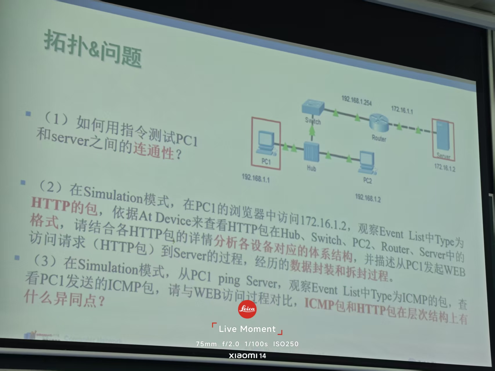
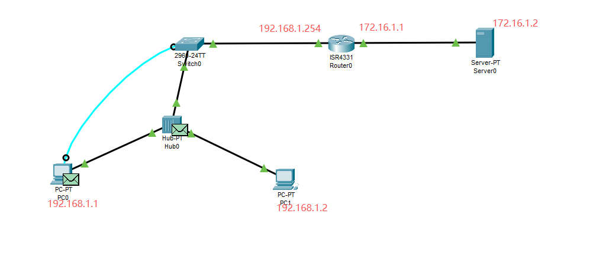
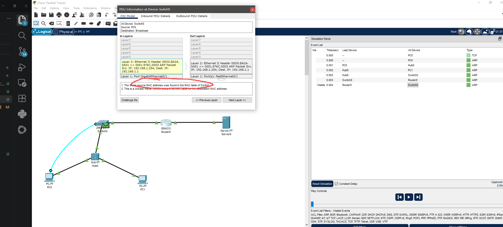

<!-- synced-from-vault: 01-Inbox/To Process/网络拓扑布局小测.md | updated: 2026-11-06 -->
# 拓扑布局

<!-- guide-start -->
> **本篇定位**：课堂小测的拓扑截图记录，文字说明尚未补全。
>
> **学习重点**：待补充：每张拓扑图对应的题目要求与结论。
>
> **自测**：待补充。

---

<!-- guide-end -->

## 相关笔记

- Inbox Dashboard
- 计算机网络知识地图

<!-- vault-sync: 由 D:/library/nico 自动同步，请勿在博客侧手工编辑 -->
