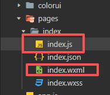
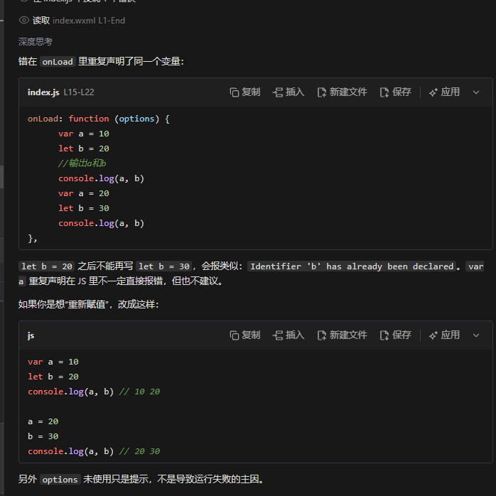
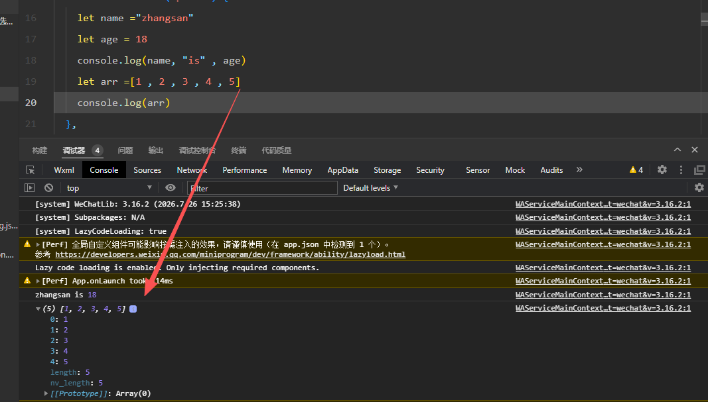
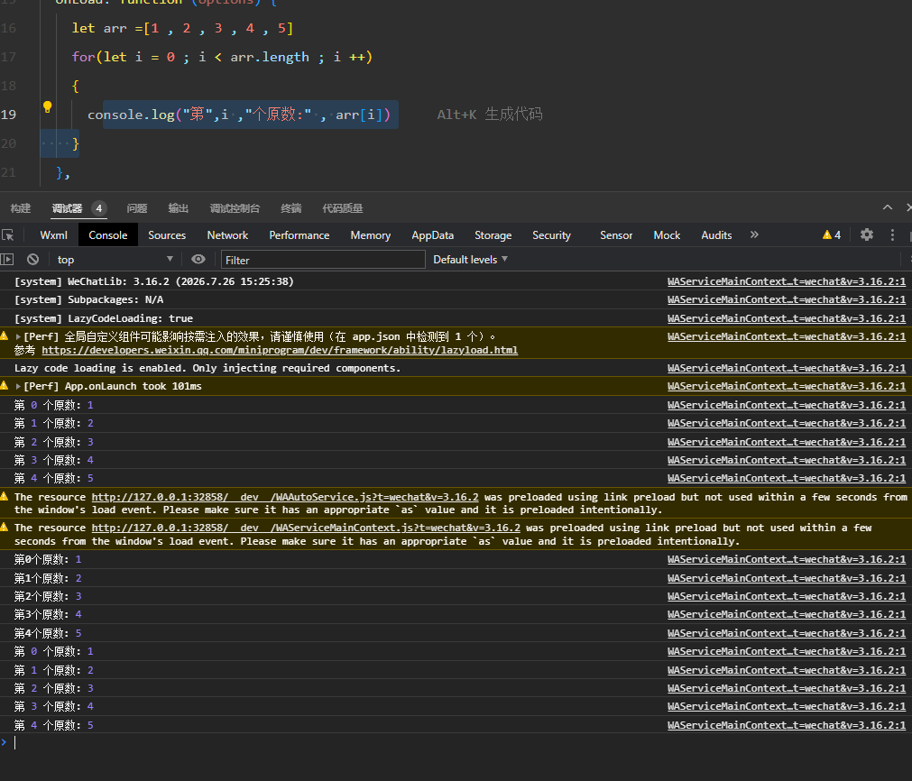
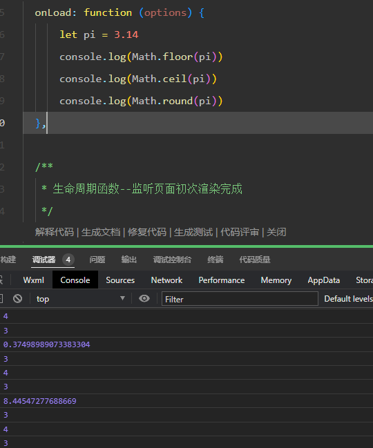
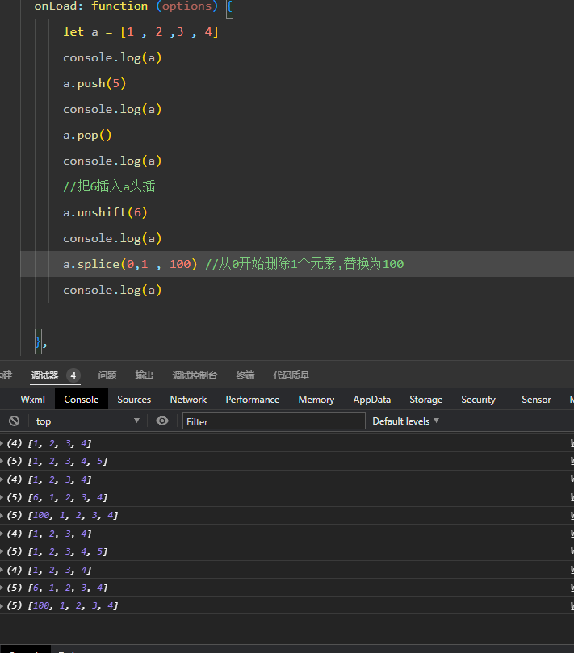
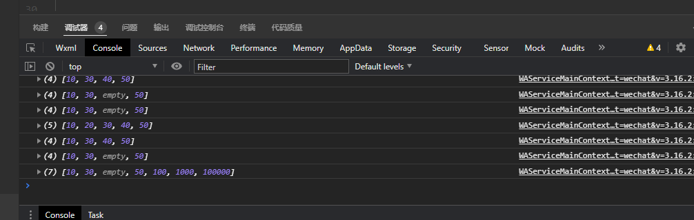

    应用程序开发是基于事件的
### Javascript

#### 语法

##### 变量
    定义变量 
```javascript
        var a = 10
        let b = 20
        //输出a和b
        console.log(a, b)
        let c = 'a'
        console.log(c)
        let d = "woshidasabi"
        let e = [1, 2, 3, 4, 5]
        let f = ["a", "b", "c"]
        //console是控制台 .log是日志
    
```

```javascript
    let name ="zhangsan"
    let age = 18
    console.log(name, "is" , age)
    let arr =[1 , 2 , 3 , 4 , 5]
    console.log(arr)
    //arr.length   arr的长度
    
```
  

  




##### 比较  
    === 严格比较  
    == 比较宽松  （遇到类型不同会转化为同一个类型一般是数字）  

##### 对象 
```js
    let person ={"name" :"sb" ,
    "age" : "11",
    "sex" : "nan"
    }
    console.log(person.age)
    console.log(person["name"])
```

##### 数组

```js
    let arr = [10,20,30]
    arr[arr.length] = 40
    arr.push(50)
    console.log(arr)
    arr.splice(1,1)
    console.log(arr)
    delete arr[2]  //删除
    console.log(arr)
    let arr2 = [100 ,1000, 100000]
    let me = arr.concat(arr2)
    console.log(me)
    //let arr2 = [100 ,1000, 100000]
    //arr.push(...arr2)
    //console.log(arr)
    //let arr2 = [100 ,1000, 100000]
    //let me = [...arr , ...arr2] //推荐
    //console.log(me)
    let newarr = arr2.splice(index , howmany) //splice是删除原数组的函数返回是个数组，howmany是个数，从index开始
```


    查找
```js
    let arr = ["sb" , "sb1","sb2"]
    let indx = arr.indexOf("sb")
    console.log(indx)
```