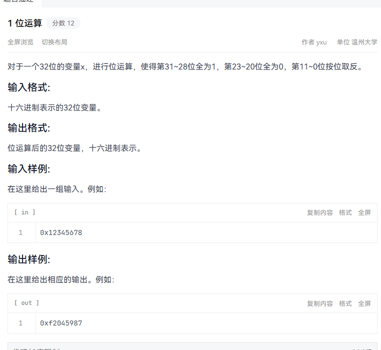
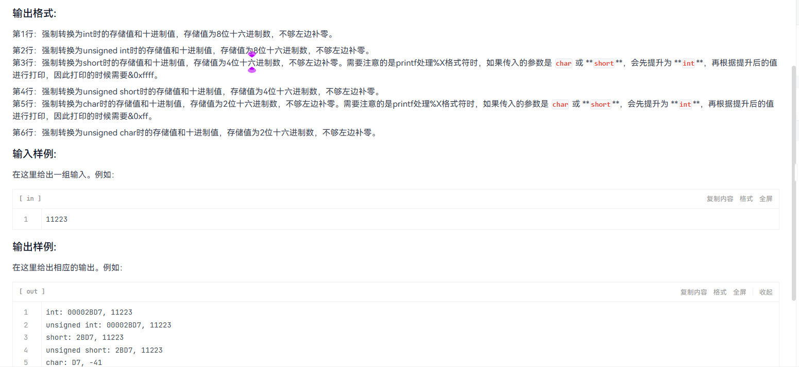

```c
    #include<bits/stdc++.h>
using namespace std;
int main()
{
    unsigned int a;
    if(scanf("%x", &a) != 1)
    {
        return 0;
    }
    a |= 0xF0000000u;
    a &= 0xFF0FFFFFu;
    a ^= 0x00000FFFu;
    printf("0x%08x\n", a);
    return 0;
}
```



```c
#include<bits/stdc++.h>
using namespace std;
int main()
{
    int x;
    if(scanf("%d", &x) != 1) return 0;
    int vi = (int)x;
    unsigned int vu = (unsigned int)x;
    short vs = (short) x;
    unsigned short vus = (unsigned short) x;
    char vc = (char) x;
    unsigned char vuc = (unsigned char) x;
    printf("int: %08X, %d\n",
          (unsigned int)((unsigned int)vi & 0xFFFFFFFFu), x);
        printf("unsigned int: %08X, %u\n",
          (unsigned int)(vu & 0xFFFFFFFFu), vu);
        printf("short: %04X, %d\n",
          (unsigned int)((unsigned int)vs & 0xFFFFu), (int)vs);
        printf("unsigned short: %04X, %u\n",
          (unsigned int)((unsigned int)vus & 0xFFFFu), (unsigned int)vus);
        printf("char: %02X, %d\n",
          (unsigned int)((unsigned int)vc & 0xFFu), (int)vc);
        printf("unsigned char: %02X, %u\n",
          (unsigned int)((unsigned int)vuc & 0xFFu), (unsigned int)vuc);
        return 0;
}
```

统计1

```c
#include<bits/stdc++.h>
using namespace std;
int main()
{
    unsigned int x;
    cin >> x;
    cout << popcount(x) <<endl;
    return 0;
}
```